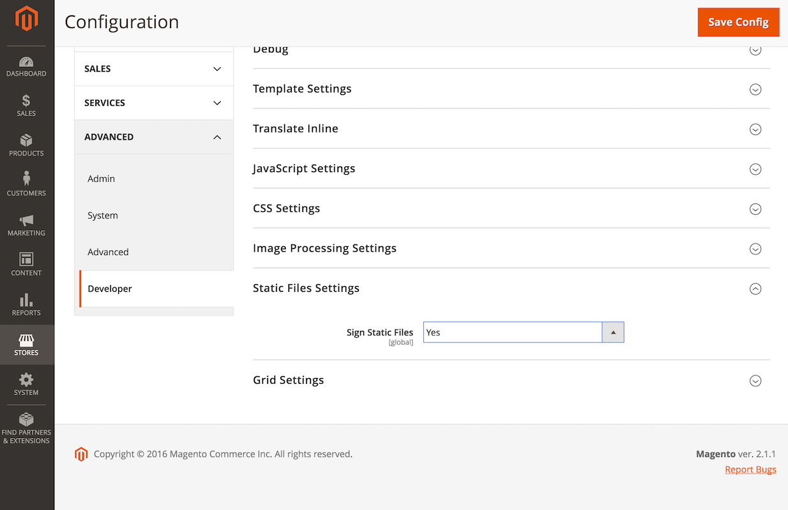

# 静的コンテンツの署名とブラウザーキャッシュの無効化

Commerceは、パフォーマンスを向上させるために、画像、JavaScript、CSS ファイルなどの静的リソースに`Expires` ヘッダーを設定します。
静的リソースに`Expires` ヘッダーを設定すると、ブラウザーはそのURLでリソースをキャッシュし、有効期限が切れるまでキャッシュされたバージョンを提供するように指示されます。
これは、静的リソースをキャッシュするための一般的な[ ベストプラクティス ](https://developer.yahoo.com/performance/rules.html#expires=)です。

ブラウザーが静的リソースをキャッシュし、そのリソースがサーバー上で変更された場合、ブラウザーのキャッシュをクリアして新しいバージョンをダウンロードできるようにする必要があります。
Web サイト管理者は、ブラウザーのキャッシュを手動でクリアできますが、静的リソースの新しいバージョンをダウンロードする場合は、ユーザーに適切なリクエストを行う必要はありません。

## 静的コンテンツ署名

静的コンテンツ署名は、静的リソースのブラウザーキャッシュを無効にできるCommerceの機能です。
Commerceでは、静的ファイルのURLにデプロイメントバージョンを追加することで、これを実現します。

次に、バージョンで署名されたURLの例を示します。

```text
http://magento2.com/pub/static/version1475604434/frontend/Magento/luma/en_US/images/logo.svg
```

静的コンテンツをデプロイするためにコマンド [`setup:static-content:deploy`](../cli/static-view-file-deployment.md)を実行すると、Commerceによってデプロイメントバージョンが自動的に変更されます。
これにより、静的ファイルのURLが変更され、ブラウザーは新しいバージョンのファイルを強制的に読み込みます。

Commerceでは、デフォルトでこの機能が有効になっています。Adobeでは、古い静的リソースを提供するブラウザーに関する問題を回避するために、この機能を有効にしておくことをお勧めします。

静的コンテンツ署名の設定は、[**[!UICONTROL Stores]**/ 設定/設定/**[!UICONTROL Advanced]**/**[!UICONTROL Developer]**/**[!UICONTROL Static Files Settings]**](https://experienceleague.adobe.com/en/docs/commerce-admin/systems/tools/developer-tools#static-file-signatures)にあります。

- **オンプレミスのみ**：この設定は、[実稼動モード ](../bootstrap/application-modes.md#production-mode)でサイトが&#x200B;**not**&#x200B;の場合に使用できます。
- **Cloud**：実稼動モードが厳密に適用されているため、この設定は非表示になっています。したがって、次に示すようにコマンドラインを使用する必要があります。



ステータスの決定：

```shell
bin/magento config:show dev/static/sign
```

静的コンテンツ署名を有効または無効にする：

```shell
bin/magento config:set dev/static/sign <value>
```

ここで、`<value>`は1 （有効）または0 （無効）です。

## バージョンの署名

Commerceは、静的なビューファイルのベース URLの直後にバージョン署名をパスコンポーネントとして追加し、静的なリソース間の相対URLの整合性を維持します。
これにより、ブラウザーは、署名値の有無に関係なく、コンテンツを保持しながら、適切な署名済みソースへの相対URLを解決する必要があります。

ブラウザーがサーバーから署名済みソースを要求すると、サーバーはURLの書き換えを使用して、署名コンポーネントをURLから削除します。

## デプロイ時の使用

静的リソースをアップグレードまたは変更した後、`setup:static-content:deploy` コマンドを実行してバージョンをデプロイし、静的コンテンツを更新する必要があります。これにより、ブラウザーは更新されたリソースを強制的に読み込みます。

別のサーバーにコードをデプロイし、ダウンタイムを減らすためにコードリポジトリを使用して実稼動に移行する場合は、ファイル `pub/static/deployed_version.txt`をリポジトリに追加する必要もあります。
このファイルには、デプロイされた静的コンテンツの新しいバージョンが含まれます。
