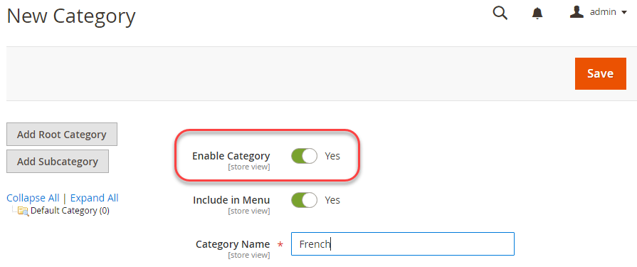
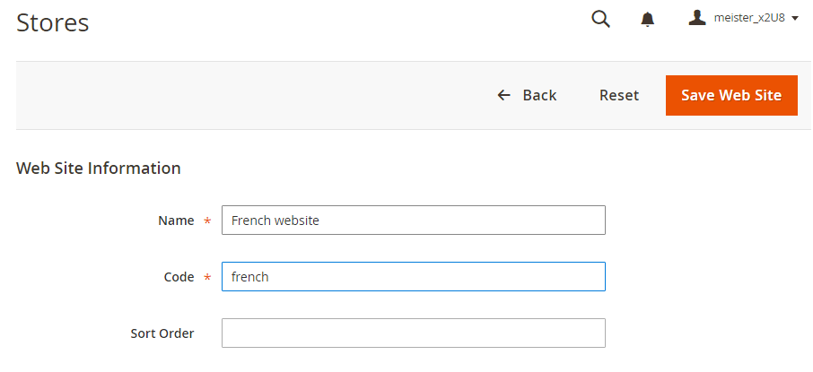
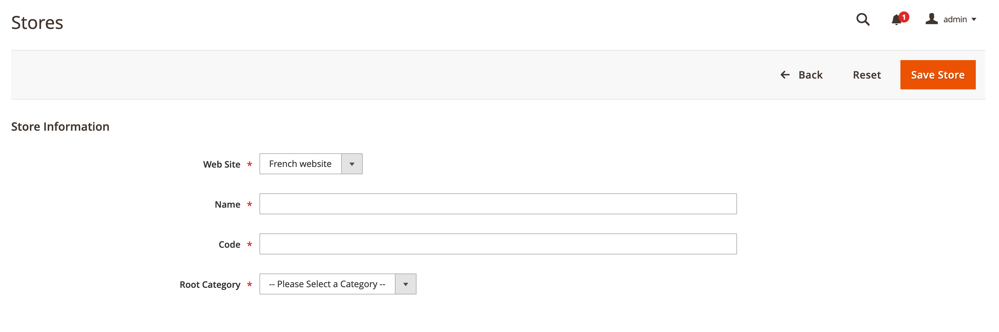
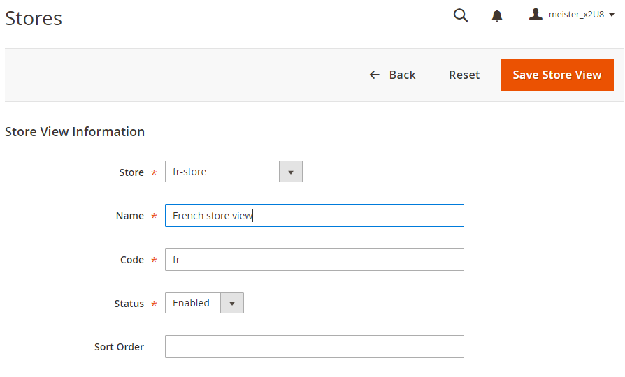
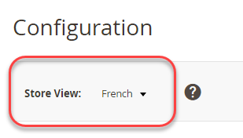
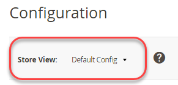
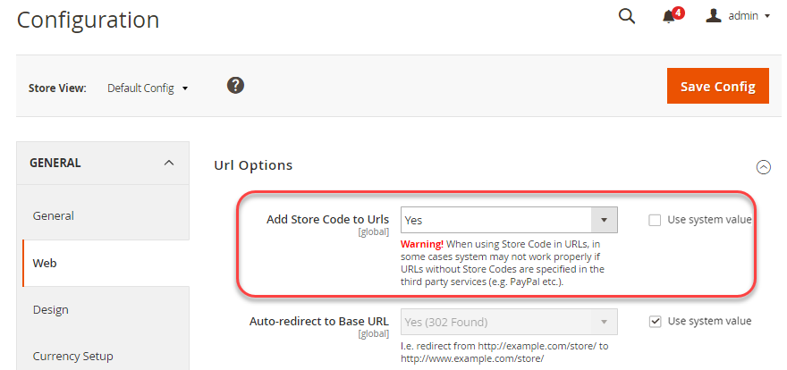

# 管理者で複数のビューを設定する

このタスクでは、各ストアのルートカテゴリ（および必要に応じて追加のカテゴリ）を作成する必要があります。 このトピックで説明するタスクは、複数のストアを設定する1つの方法を提供します。 詳しくは、Commerce ユーザーガイドの次の資料を参照してください。

- [カテゴリ](https://experienceleague.adobe.com/en/docs/commerce-admin/catalog/categories/categories)
- [Web サイトの追加](https://experienceleague.adobe.com/en/docs/commerce-admin/stores-sales/site-store/stores#add-websites)
- [URLの保存](https://experienceleague.adobe.com/en/docs/commerce-admin/stores-sales/site-store/store-urls)
- [コンテンツ](https://experienceleague.adobe.com/en/docs/commerce-admin/content-design/content-menu)

>[!INFO]
>
>例えば、このトピックでは、web サイトのコード `french`を含むフランスのweb サイトのみを使用します。 ステップバイステップチュートリアルについては、[ チュートリアル：Apacheを使用して複数のweb サイトを設定](ms-apache.md)および[ チュートリアル：nginx](ms-nginx.md)を使用して複数のweb サイトを設定する

## 手順1：ルートカテゴリの作成

ルートカテゴリの作成はオプションですが、このチュートリアルでは、各web サイトに一意のルートカテゴリを持たせたい場合に使用する方法を説明します。 必要に応じて、カテゴリーを追加することもできます。

ルートカテゴリを作成するには：

1. カテゴリの作成を許可されたユーザーとして、管理者にログインします。
1. **カタログ**/**カテゴリー**&#x200B;をクリックします。
1. 「**ルートカテゴリを追加**」をクリックします。
1. 「**カテゴリ名**」フィールドに、このカテゴリを識別するための一意の名前を入力します。
1. 「カテゴリを有効にする」が&#x200B;**はい**&#x200B;に設定されていることを確認します。

   このページのその他のオプションについて詳しくは、[ ルートカテゴリ ](https://experienceleague.adobe.com/en/docs/commerce-admin/catalog/categories/category-root)を参照してください。

   次の図は、例を示しています。

   

1. **保存**&#x200B;をクリックします。
1. これらのタスクを必要な回数だけ繰り返して、ストアのルートカテゴリを作成します。

## ステップ 2:web サイトの作成

Web サイトを作成するには：

1. Web サイト、ストア、ストアビューの作成を許可されたユーザーとして管理者にログインします。
1. **ストア** > **設定** > **すべてのストア**&#x200B;をクリックします。
1. _ストア_ ページで、**Web サイトの作成**&#x200B;をクリックします。

   - **名前** - Web サイトを識別する名前を入力します。
   - **コード** – 一意のコードを入力します。例えば、フランスの店舗がある場合は、`french`と入力できます
   - **並べ替え順序** - オプションの数値の並べ替え順序を入力します。

   次の図は、例を示しています。

   

1. 「**Web サイトを保存**」をクリックします。
1. web サイトを構築するために、必要に応じてこれらのタスクを繰り返します。

## ステップ 3：ストアの作成

ストアを作成するには：

1. _管理者_ パネルで、**ストア** > **設定** > **すべてのストア**&#x200B;をクリックします。
1. _ストア_ ページで、**ストアの作成**&#x200B;をクリックします。

   - **Web サイト** – このストアを関連付けるWeb サイトの名前をクリックします。
   - **名前** – ストアを識別する名前を入力します。
   - **Code**：ストアを識別するための一意のコードを入力します。
   - **ルートカテゴリ** – このストアのルートカテゴリの名前をクリックします。

   次の図は、例を示しています。

   

1. 「**ストアを保存**」をクリックします。
1. これらのタスクを必要な回数だけ繰り返して、ストアを作成します。

## ステップ 4：ストアビューの作成

ストアビューを作成するには：

1. _管理者_ パネルで、**ストア** > **設定** > **すべてのストア**&#x200B;をクリックします。
1. ストアページで、**ストアビューの作成**&#x200B;をクリックします。

   - **ストア** – このストアビューを関連付けるストアの名前をクリックします。
   - **名前** – このストアビューを識別する名前を入力します。
   - **コード** – このストアビューを識別するための一意の名前を入力します。
   - **ステータス** - **有効**&#x200B;を選択します。

   次の図は、例を示しています。

   

1. 「**ストアビューを保存**」をクリックします。
1. これらのタスクを必要な回数だけ繰り返して、ストアビューを作成します。

## 手順5:web サイトのベース URLの変更

`http://french.magento.mg`のような一意のURLを使用してweb サイトにアクセスするには、管理者の各サイトのベース URLを変更する必要があります。

Web サイトのベース URLを変更するには：

1. _管理者_ パネルで、**ストア** > **設定** > **構成** > **一般** > **Web**&#x200B;をクリックします。
1. ページ上部の&#x200B;**ストアビュー** リストから、次の図に示すように、Web サイトの1つの名前をクリックします。

   

1. 右側のペインで、**Base URL**&#x200B;を展開します。
1. _Base URL_ セクションで、**システム値を使用**&#x200B;をクリアします。
1. **基本URL**&#x200B;および&#x200B;**基本リンク URL** フィールドに`http://french.magento.mg` URLを入力します。

1. 「_ベース URL （セキュア）_」セクションで前の手順を繰り返します。

   >[!INFO]
   >
   >クラウドインフラストラクチャ上にAdobe Commerceをデプロイするためのベース URLを設定する場合は、最初のピリオドを3つのダッシュに置き換える必要があります。 例えば、ベース URLが`french.branch-sbg7pPa-f3dueAiM03tpy.us.magentosite.cloud`の場合は、`http://french---branch-sbg7pPa-f3dueAiM03tpy.us.magentosite.cloud`と入力します。 ローカルテスト用のベース URLを設定する場合は、ピリオドを使用します。

1. 「**設定を保存**」をクリックします。

1. 他のweb サイトでもこれらの作業を繰り返します。

## 手順6：ストアコードをベース URLに追加

Commerceでは、ストアコードをサイトベース URLに追加するオプションが用意されています。これにより、複数のストアを設定するプロセスが簡素化されます。 このオプションを使用すると、`index.php`および`.htaccess`を格納するためにCommerce ファイルシステムにディレクトリを作成する必要はありません。

これにより、`index.php`と`.htaccess`が今後のアップグレードでCommerce コードベースと同期しなくなります。

[Commerce ユーザーガイド ](https://experienceleague.adobe.com/en/docs/commerce-admin/stores-sales/site-store/store-urls)を参照してください。

ストアコードをベース URLに追加するには：

1. _管理者_ パネルで、**ストア** > **設定** > **構成** > **一般** > **Web**&#x200B;をクリックします。
1. ページの上部にある&#x200B;**ストアビュー** リストから、**デフォルト設定**&#x200B;をクリックします。次の図に示すように。

   

1. 右側のペインで、**Url オプション**&#x200B;を展開します。
1. 「_ストア コードをUrl_&#x200B;に追加」の横にある「**システム値を使用**」チェックボックスをオフにします。
1. _ストア コードをUrl_&#x200B;に追加リストから、**はい**&#x200B;をクリックします。

   にストアコードを追加します

1. 「**設定を保存**」をクリックします。
1. プロンプトが表示されたら、キャッシュをフラッシュします。 （**システム** > **キャッシュ管理**）。

## 手順7：デフォルトのストアビューベース URLの変更

管理者へのアクセス権を失うため、この手順を最後に実行する必要があります。アクセス権は、web サーバー固有のトピックで説明されているように、仮想ホストを設定した後に返されます。

デフォルトのストアビューベース URLを変更するには：

1. _管理者_ パネルで、**ストア** > **設定** > **構成** > **一般** > **Web**&#x200B;をクリックします。

1. ページ上部の&#x200B;_ストアビュー_ リストから、**デフォルト設定**&#x200B;をクリックします。

   

1. 右側のペインで、**Base URL**&#x200B;を展開します。
1. _Base URL_ セクションで、**システム値を使用**&#x200B;をクリアします。
1. **基本URL**&#x200B;および&#x200B;**基本リンク URL** フィールドに`http://magento.mg` URLを入力します。

1. 「**ベース URL （セキュア）**」セクションで前の手順を繰り返します。

   >[!INFO]
   >
   >クラウドインフラストラクチャ上でAdobe Commerceのベース URLを設定する場合は、最初のピリオドを3つのダッシュに置き換える必要があります。 例えば、ベース URLが`french.branch-sbg7pPa-f3dueAiM03tpy.us.magentosite.cloud`の場合、`http://french---branch-sbg7pPa-f3dueAiM03tpy.us.magentosite.cloud`と入力します

1. 「**設定を保存**」をクリックします。

>[!INFO]
>
>web サイト、ストア、およびストアビューのコードには、文字（a ～ zまたはA ～ Z）、数字（0 ～ 9）、およびアンダースコア（_）のみを含めることができます。 また、最初の文字は文字でなければなりません。 大文字またはキャメルケースを使用する場合、内部的に一致は大文字と小文字を区別せず、環境変数を使用して設定設定を上書きできます。 [環境変数を使用して構成設定を上書きする](../reference/override-config-settings.md#environment-variables)を参照してください。