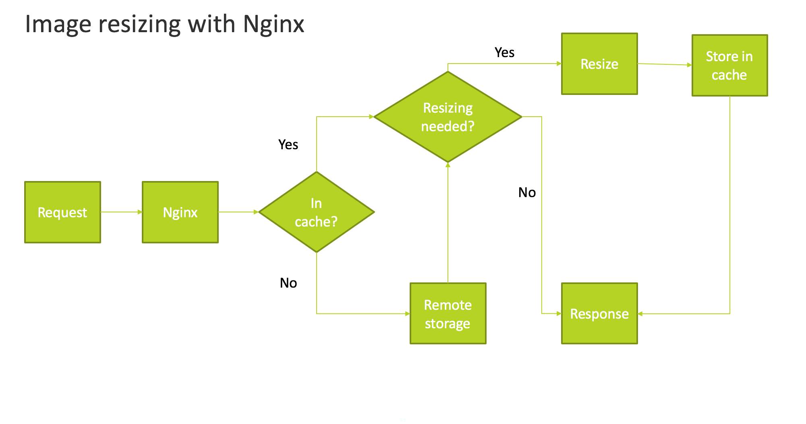

# リモートストレージ用の画像サイズ変更の設定

デフォルトでは、Adobe Commerceはアプリケーション側での画像のサイズ変更をサポートしています。 ただし、リモートストレージモジュールを有効にすることで、Nginxを使用して画像サイズをサーバーサイドにオフロードし、ディスクリソースを保存してディスク使用を最適化できます。

次の図は、Nginxがキャッシュ内の画像を取得、サイズ変更、および保存する方法を示しています。 サイズ変更は、高さや幅など、URLに含まれるパラメーターによって決まります。



>[!TIP]
>
>クラウドインフラストラクチャプロジェクト上のAdobe Commerceについては、[ クラウドインフラストラクチャ上のCommerceのリモートストレージの設定](cloud-support.md)を参照してください

## Adobe CommerceでのURL フォーマットの設定

サーバーサイドの画像のサイズを変更するには、Adobe Commerceを設定して、画像の高さ、幅、場所（URL）に関する引数を指定する必要があります。

**サーバーサイドの画像サイズ変更**&#x200B;用にCommerceを設定するには：

1. _管理者_ パネルで、**[!UICONTROL Stores]** > **[!UICONTROL Settings]** > **[!UICONTROL Configuration]** > **[!UICONTROL General]** > **[!UICONTROL Web]**&#x200B;をクリックします。

1. 右側のウィンドウで、**[!UICONTROL Url options]**&#x200B;を展開します。

1. _カタログメディア URL形式_ セクションで、**[!UICONTROL Use system value]**&#x200B;をクリアします。

1. 「**_カタログメディア URL形式_**」フィールドで「`Image optimization based on query parameters` URL」を選択します。

1. **[!UICONTROL Save Config]**&#x200B;をクリックします。

1. [Nginx設定](#configure-nginx)に進みます。

## Nginxの設定

サーバーサイド画像のサイズ変更を引き続き設定するには、`nginx.conf` ファイルを準備し、選択したアダプターに`proxy_pass`値を指定する必要があります。

**Nginxによる画像サイズの変更を有効にするには**:

1. [Nginx画像フィルターモジュール ](https://nginx.org/en/docs/http/ngx_http_image_filter_module.html)をインストールします。

   ```shell
   load_module /etc/nginx/modules/ngx_http_image_filter_module.so;
   ```

1. 含まれているテンプレート `nginx.conf.sample` ファイルに基づいて`nginx.conf` ファイルを作成します。 例：

   ```conf
   location ~* \.(jpg|jpeg|png|gif|webp)$ {
       set $width "-";
       set $height "-";
       if ($arg_width != '') {
           set $width $arg_width;
       }
       if ($arg_height != '') {
           set $height $arg_height;
       }
       image_filter resize $width $height;
       image_filter_jpeg_quality 90;
   }
   ```

1. [_オプション_]&#x200B;特定のアダプタに`proxy_pass`値を設定します。

   - [Amazon Simple Storage Service （Amazon S3）](remote-storage-aws-s3.md)

