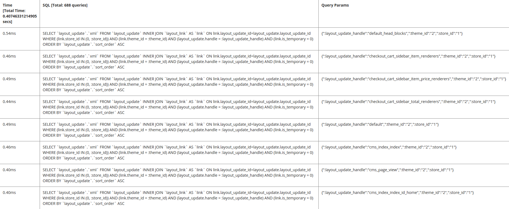

# データベースプロファイラーの設定

Commerce データベースプロファイラーは、各クエリの時間と適用されたパラメーターを含め、ページに実装されたすべてのクエリを表示します。

## 手順1：デプロイメント設定の変更

`<magento_root>/app/etc/env.php`を変更して、[&#x200B; データベースプロファイラークラス &#x200B;](https://github.com/magento/magento2/tree/2.4/lib/internal/Magento/Framework/DB/Profiler.php)に次の参照を追加します。

```php?start_inline=1
        'profiler' => [
            'class' => '\Magento\Framework\DB\Profiler',
            'enabled' => true,
        ],
```

例は次のとおりです。

```php?start_inline=1
 'db' =>
  array (
    'table_prefix' => '',
    'connection' =>
    array (
      'default' =>
      array (
        'host' => 'localhost',
        'dbname' => 'magento',
        'username' => 'magento',
        'password' => 'magento',
        'model' => 'mysql4',
        'engine' => 'innodb',
        'initStatements' => 'SET NAMES utf8;',
        'active' => '1',
        'profiler' => [
            'class' => '\Magento\Framework\DB\Profiler',
            'enabled' => true,
        ],
      ),
    ),
  ),
```

## 手順2：出力の設定

Commerce アプリケーションのブートストラップファイルで出力を設定します。これは`<magento_root>/pub/index.php`であるか、web サーバーの仮想ホスト設定に配置されている可能性があります。

次の例では、結果を3列のテーブルに表示します。

- 合計時間（ページ上のすべてのクエリを実行する合計時間を表示）
- SQL （すべてのSQL クエリを表示します。行ヘッダーにはクエリの数が表示されます）
- クエリパラメーター（各SQL クエリのパラメーターを表示）

出力を設定するには、ブートストラップファイルの`$bootstrap->run($app);`行の後に次の行を追加します。

```php?start_inline=1
/** @var \Magento\Framework\App\ResourceConnection $res */
$res = \Magento\Framework\App\ObjectManager::getInstance()->get('Magento\Framework\App\ResourceConnection');
/** @var Magento\Framework\DB\Profiler $profiler */
$profiler = $res->getConnection('read')->getProfiler();
echo "<table cellpadding='0' cellspacing='0' border='1'>";
echo "<tr>";
echo "<th>Time <br/>[Total Time: ".$profiler->getTotalElapsedSecs()." secs]</th>";
echo "<th>SQL [Total: ".$profiler->getTotalNumQueries()." queries]</th>";
echo "<th>Query Params</th>";
echo "</tr>";
foreach ($profiler->getQueryProfiles() as $query) {
    /** @var Zend_Db_Profiler_Query $query*/
    echo '<tr>';
    echo '<td>', number_format(1000 * $query->getElapsedSecs(), 2), 'ms', '</td>';
    echo '<td>', $query->getQuery(), '</td>';
    echo '<td>', json_encode($query->getQueryParams()), '</td>';
    echo '</tr>';
}
echo "</table>";
```

## 手順3：結果の表示

ストアフロントまたは管理画面の任意のページに移動して、結果を表示します。 サンプルは次のとおりです。


