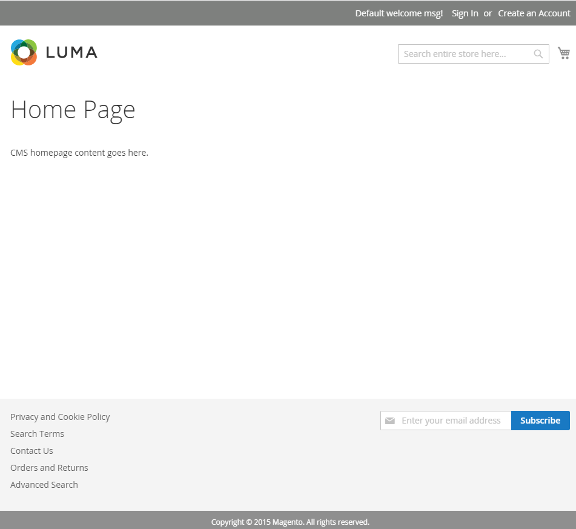

# インストールの確認

web ブラウザーでストアフロントに移動します。 例えば、インストールベース URLが`http://www.example.com`の場合、ブラウザーのアドレスまたはロケーションバーに入力します。

次の図は、ストアフロントページの例を示しています。 次のように表示される場合、インストールは成功しました。

## ストアフロントの検証（サンプルデータなし）

web ブラウザーでストアフロントに移動します。 例えば、インストールベース URLが`http://www.example.com`の場合、ブラウザーのアドレスまたはロケーションバーに入力します。

次の図は、ストアフロントページの例を示しています。 次のように表示される場合、インストールは成功しました。

ページに`404 (Not Found)` エラーが表示されるか、スタイルが表示されない場合は、[ トラブルシューティング ](https://support.magento.com/hc/en-us/articles/360032994352)を参照してください。

## 管理者の確認

Web ブラウザーの管理者に移動します。 例えば、インストールベース URLが`http://www.example.com`、管理者URIが`admin_au1nT`の場合、ブラウザーのアドレスまたはロケーションバーに`http://www.example.com/admin_au1nT`と入力します。

（管理者URIは、`backend-frontname` インストールパラメーターの値で指定されます）。

プロンプトが表示されたら、管理者としてログインします。

次の図は、Admin ページの例を示しています。 次のように表示される場合、インストールは成功しました。

ページにスタイルが表示されない場合は、[ トラブルシューティング ](https://support.magento.com/hc/en-us/articles/360032994352)を参照してください。

次のような404 （見つかりません）エラーが発生した場合は、[PHPのバージョンエラーまたはブラウザーでAdobe Commerceにアクセスする際の404を参照してください](https://support.magento.com/hc/en-us/articles/360033117152)。

`The requested URL /magento2index.php/admin/admin/dashboard/index/key/0c81957145a968b697c32a846598dc2e/ was not found on this server.`
