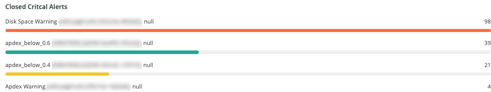

# 「[!UICONTROL Alerts]」タブ

「[!UICONTROL Alerts]」タブには、オープンおよびクローズのクリティカルアラートを含む、様々なアラートが表示されます。

## [!UICONTROL Open Alert Details]

**[!UICONTROL Open Alert Details]** フレームには、選択した時間枠で開いているクリティカルアラートの数が表示されます。 このアラートには、Adobeで作成されたアラートと、パートナーまたはマーチャントが作成したアラートが含まれます。

## [!UICONTROL Closed Critical Alerts]

**[!UICONTROL Closed Critical Alerts]** フレームには、選択した時間枠のクローズ済みクリティカルアラートの数が表示されます。 このアラートには、Adobeで作成されたアラートと、パートナーまたはマーチャントが作成したアラートが含まれます。

## [!UICONTROL Critical Alert Details]

**[!UICONTROL Critical Alert Details]** フレームには、タイムスタンプ、条件名、およびアラートイベントが開いているか閉じているかなど、選択した時間枠のクリティカルアラートの詳細のカウントが表示されます。

## [!UICONTROL Infrastructure Alert Details]

**[!UICONTROL Infrastructure Alert Details]** フレームには、選択した期間のアプリケーション、ホスト、およびその他のインフラストラクチャ イベントが表示されます。
