# 「[!UICONTROL CDN]」タブ

このタブには、[!DNL content delivery network (CDN)]に焦点を当てた情報があります。 Adobe Commerce Cloudの場合、これは[!DNL Fastly] サービスです。

## [!UICONTROL HIT rate]

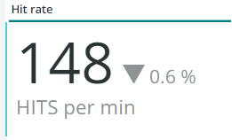

**[!UICONTROL HIT rate]** フレームには、最後の1分間に[!UICONTROL HITS]に至ったキャッシュ可能なリクエストの数が表示されます。 これは、キャッシュが成功したことを示します。 右側の矢印は、1週間前の同じ時間に上下の割合を示します。

## [!UICONTROL HIT Processing]

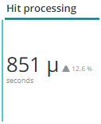

この&#x200B;**[!UICONTROL HIT processing]** ボックスには、1週間に[!UICONTROL HITS]が発生したキャッシュ可能なリクエストの数が表示されます。

## [!UICONTROL MISS rate]

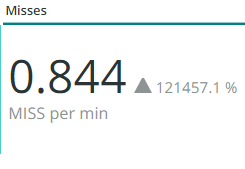

この&#x200B;**[!UICONTROL MISS rate]** ボックスには、最後の1分間にキャッシュ可能な要求が失敗した回数が表示されます。 失敗とは、リクエストがキャッシュされないときに、コンテンツを提供するためにリクエストをオリジンサーバーに渡す必要がある場合です。 右の値は、1週間前の1分あたりの分数の増減の比較です。

## [!UICONTROL MISS time]

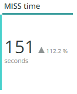

## [!UICONTROL HIT Ratio]

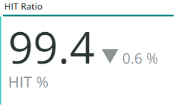

## [!UICONTROL Error Percentage]

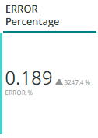

**[!UICONTROL Error Percentage]** ボックスには、リクエストのERROR パーセンテージの値が表示され、1週間前の同じ時間と比較した相対的な増減が表示されます。

## [!UICONTROL Total Requests]

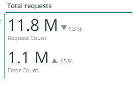

## [!UICONTROL ERROR rate]

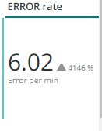

## [!UICONTROL Fastly Cache Average Response for selected time period in seconds]

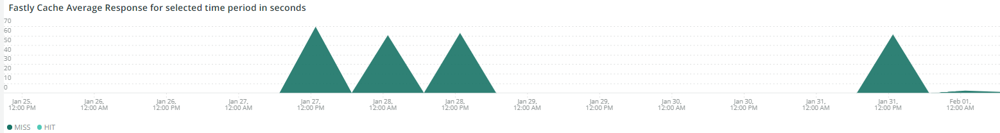

このフレームは、キャッシュ可能なリクエストの期間を秒単位で示します。つまり、`cache_response`が[!UICONTROL MISS]の場合、選択した時間のキャッシュされた応答が欠落した場合の平均が表示されます。

## [!UICONTROL Fastly Cache Average Response for selected time period in seconds, faceted by POP]

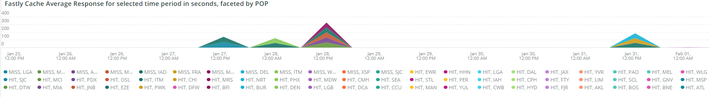

このコンテキストの&#x200B;*POP*&#x200B;は、キャッシュ ストレージのプールとして機能するように構成されたPOP （Point of Presence）を指します。 [&#x200B; プレゼンスのポイント &#x200B;](https://developer.fastly.com/learning/concepts/pop/)を参照してください。

## [!UICONTROL Total Bandwidth (All POPs) during the selected timeframe, compared with 1 week ago (% increase/decrease)]

選択した時間枠内の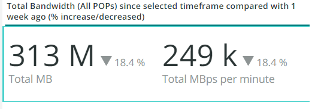

## [!UICONTROL Requests – Since selected timeframe compared with one week ago]

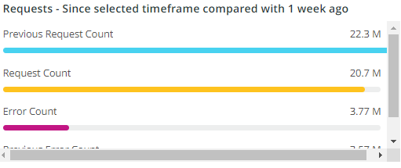

このフレームは、上部の[!UICONTROL Total Requests]の概要ボックスと似ていますが、前週のリクエスト数が表示されます。 これらは、キャッシュ可能なリクエストだけでなく、すべてのリクエストです（`is_cacheable`がtrueの場合）。

## [!UICONTROL Response Count]

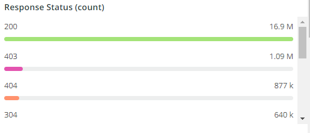

## [!UICONTROL Bandwidth by POP]

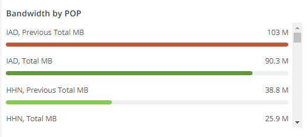

## [!UICONTROL Top 5 URLs (5xx or 3xx status codes)]

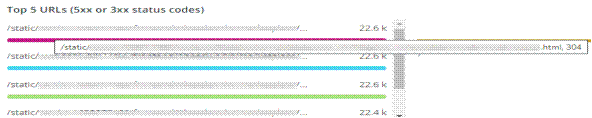

**[!UICONTROL Top 5 URLs]** ビューには、5xxまたは3xx エラー応答が発生しているURLの上位5件が表示されます。 スペース制約のため、URLにマウスポインターを置いて、そのURLに関連付けられている特定のエラーコードを確認する必要があります。 （上の図の赤いボックスの例）。

## [!UICONTROL Top 25 URLs (200 status)]

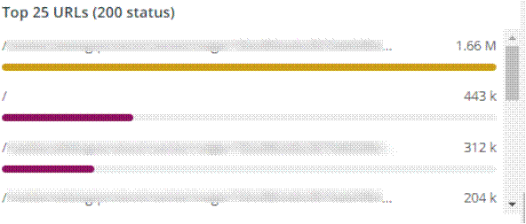

**[!UICONTROL Top 25 URLs]** フレームには、選択した期間にカウント別に200 ステータスを返したURLが表示されます。

## [!UICONTROL Duration by Response Status]

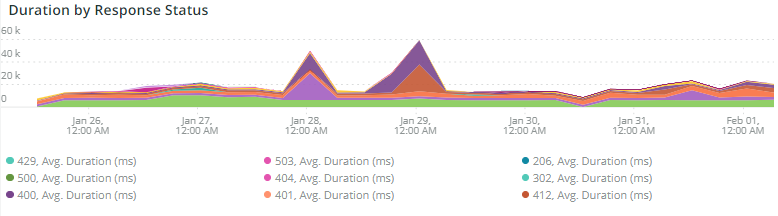

**[!UICONTROL Duration by Response Status]** グラフには、選択した期間のエラー応答がカウント別に表示されます。エラーステータスコードがファセットになっています。

## [!UICONTROL Duration by Response Status, top 25 urls]

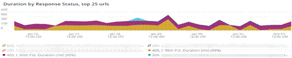

**[!UICONTROL Duration by Response Status, top 25 URLs]** グラフには、応答時間を秒単位で示す上位25個のURLが表示されます。 パス全体を表示するには、URLにマウスを合わせる必要がある場合があります。 また、1つのURLを除くすべてを削除するには、そのURLをクリックします。 その後、他のURLを個別にクリックして戻すことができます。 個々のURLを削除する場合は、キーを押しながら各URLをクリックして、グラフから削除できます。

## [!UICONTROL Duration by Response Status, top 25 non-200 status]

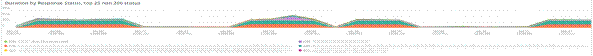

**[!UICONTROL Duration by Response Status, top 25 non-200 status]** グラフは、200以外のステータスコードまたはエラーステータスコードに焦点を当てていることを除けば、最後のグラフと似ています。 エラーコードとURLが表示されます。 パス全体を表示するには、URLにマウスを合わせる必要がある場合があります。 また、1つのURLを除くすべてを削除するには、そのURLをクリックします。 その後、他のURLを個別にクリックして戻すことができます。 個々のURLを削除する場合は、キーを押しながら各URLをクリックして、グラフから削除できます。

## [!UICONTROL Error Count by POP timeline]

POP タイムライン別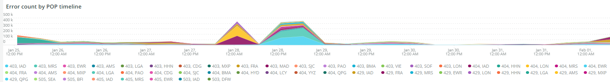

**[!UICONTROL Error Count by POP timeline]** グラフには、選択した時間枠タイムラインに沿ったエラーステータスのカウントが、エラーコードによってファセットされて表示されます。

## [!UICONTROL Duration by Response status, top 25 client IP, non-200 status]

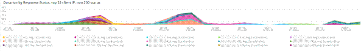による期間

**[!UICONTROL Duration by Response status, top 25 client IP, non 200 status]** グラフには、選択した時間枠でステータスエラーコードが発生した場合の平均期間によるIP アドレスが表示されます。

## [!UICONTROL IP Frequency]

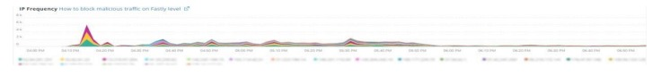

**[!UICONTROL IP Frequency]** フレームは、[!DNL Fastly] ログから各IPの（&#39;MISS&#39;および&#39;PASS&#39;） ステータスをカウントします。 これらのステータスを持つweb リクエストは、オリジンサーバーに到達し、サーバーにロードを追加します。 上位20個のアドレスが頻度で表示されます。 このフレームは、web サイト上のIP攻撃や負荷の高いソースを検出するために使用できます。 このグラフは概要タブにも表示され、このタブに表示される[!DNL Fastly] ログ情報の詳細を簡単に比較するためにここに配置されます。
