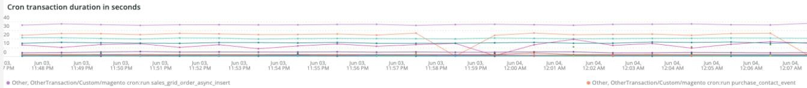
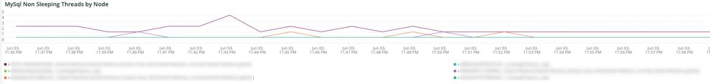
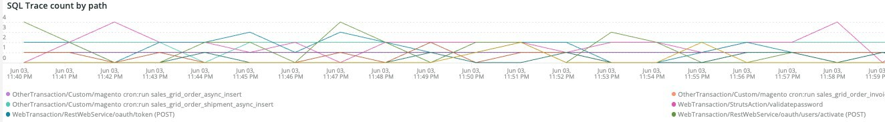
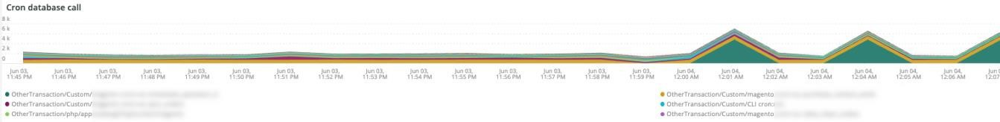
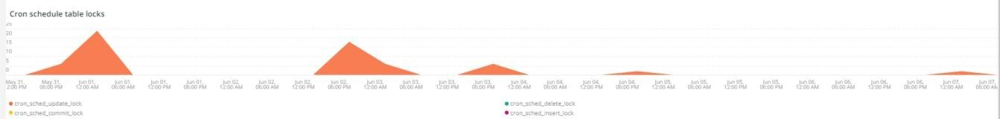
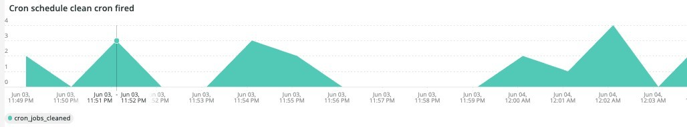
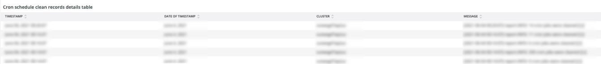
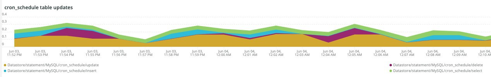
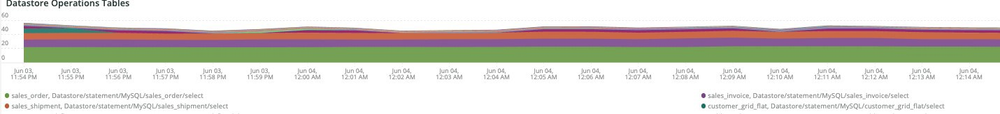

# 「[!DNL Cron]」タブ

このタブは、[!DNL cron]個の問題の問題と原因を迅速に特定する試みです。

## [!UICONTROL Cron transaction duration in seconds]

**[!UICONTROL Cron transaction duration in seconds]** フレームには、[!DNL crons] トランザクション期間が秒単位で表示されます。 これにより、実行時間が長いトランザクションが表示されます。 APMの詳細では、トランザクション/オペレーションが実行している可能性のあるクエリの詳細が表示されます。

## [!UICONTROL MySQL Non-Sleeping Threads by Node]

**[!UICONTROL MySQL Non-Sleeping Threads by Node]** フレームには、選択した時間枠のノード別のMySQL非スリープスレッドが表示されます。

## [!UICONTROL SQL Trace count by path]

パス別

**[!UICONTROL SQL Trace count by path]** フレームは、MySQL トレース数をパス別に表示します。これは、選択した期間にわたってSQL ステートメントをトレースするのに役立ちます。

## [!UICONTROL Cron database call]

**[!UICONTROL Cron database call]** フレームは、選択した期間におけるデータベースへの[!DNL crons]呼び出し回数を調べます。

## [!UICONTROL Cron schedule table locks]

**[!UICONTROL Cron schedule table locks]** フレームは、選択した時間枠で[!DNL cron]個のスケジュール テーブルのロックを確認します。

## [!UICONTROL Cron schedule clean cron fired]

**[!UICONTROL Cron schedule clean cron fired]** フレームは、選択した時間枠でクリーンアップされた[!DNL crons]の数を調べます。 このフレームにデータが表示されない場合は、[!DNL crons]が正しく実行されていないという問題を示している可能性があります。 [!DNL cron] ジョブ スケジュールがクリーニングされない場合、[!DNL crons]は最適に実行されず、実行に時間がかかる可能性があります。

## [!UICONTROL Cron schedule clean records details table]

**[!UICONTROL Cron schedule clean records details table]** テーブルには、選択した期間にわたって`cron_schedule` テーブルからレコードをクリーニングするジョブの詳細が表示されます。

## [!UICONTROL cron_schedule table updates]

**[!UICONTROL cron_schedule table updates]** フレームは、選択した期間における[!DNL cron]件のスケジュールされたテーブル更新の数を調べます。 このテーブルの削除または更新に関するアクティビティが多い場合は、[!DNL crons]に関する問題を示している可能性があります。 また、[!DNL crons]は、実行および完了時にこのテーブルを更新するので、このテーブルにアクティビティがなく、[!DNL crons]が設定されている場合、[!DNL crons]に問題が発生する可能性があります。

## [!UICONTROL Datastore Operations Tables]

**[!UICONTROL Datastore Operations Tables]**&#x200B;は、選択した期間の`SELECT`、`DELETE`および`UPDATE`を含むデータベース テーブル操作を確認します。 このフレームは、データベースのテーブルに対して最も高い操作頻度を示しています。
