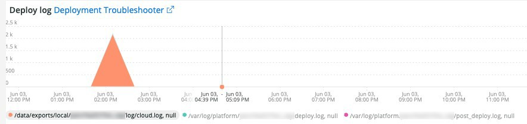
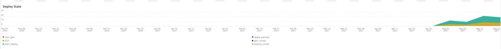
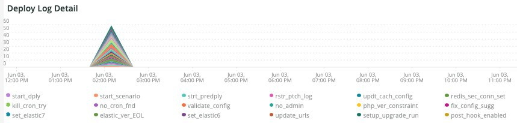
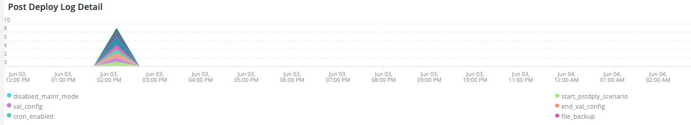
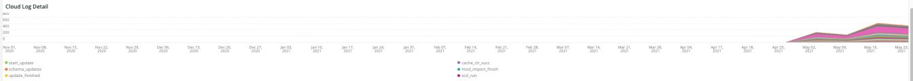
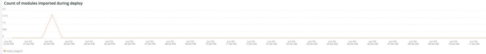
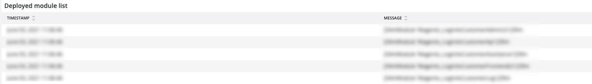

# 「[!UICONTROL Deploy]」タブ

このタブでは、デプロイメントの問題と原因を迅速に特定します。

## [!UICONTROL Deploy log Deployment Troubleshooter]

をデプロイ

**[!UICONTROL Deploy log Deployment Troubleshooter]** フレームには、選択した期間に発生したデプロイ ログ イベントの数が表示されます。 その目的は、デプロイメント アクティビティを一目で把握し、デプロイメントの複雑さをカウントで判断することです。 メッセージのログを記録すればするほど、通常のデプロイメントは複雑になります。

## [!UICONTROL Deploy State]

**[!UICONTROL Deploy State]** フレームには、選択した時間枠で発生したデプロイイベントが表示されます。 このフレームのパーサーは、次のような特定のシグナルを探します。

* &#39;`%NOTICE: Starting generate command%`&#39;） as &#39;`start_gen`&#39;
* &#39;`%git apply /app/vendor/magento/ece-tools/patches%`&#39;） as &#39;`apply_patches`&#39;
* &#39;`%Set flag: .static_content_deploy%`&#39;） as &#39;`SCD`&#39;
* &#39;`%NOTICE: Generate command completed%`&#39;） as &#39;`gen_compl`&#39;
* &#39;`%NOTICE: Starting deploy.%`&#39;） as &#39;`start_deploy`&#39;
* &#39;`%NOTICE: Deployment completed%`&#39;） as &#39;`deploy_compl`&#39;
* &#39;`%NOTICE: Starting post-deploy.%`&#39;） as &#39;`start_pdeploy`&#39;
* &#39;`%NOTICE: Post-deploy is complete%`&#39;） as &#39;`pdeploy`&#39;
* &#39;`%deploy-complete%`&#39;） as &#39;`cl_deploy_compl`&#39;

## [!UICONTROL Deploy Log Detail]

**[!UICONTROL Deploy Log Detail]** フレームには、選択した期間に発生したデプロイ ログ メッセージの概要の詳細が表示されます。 デプロイメントログ内の次の文字列のフレームが解析されています。

* &#39;`%NOTICE: Starting deploy.%`&#39;） as &#39;`start_dply`&#39;
* &#39;`%INFO: Starting scenario(s): scenario/deploy.xml%`&#39;） as &#39;`start_scenario`&#39;
* &#39;`%NOTICE: Starting pre-deploy%`&#39;） as &#39;`strt_predply`&#39;
* &#39;`%INFO: Restoring patch log file%`&#39;） as &#39;`rstr_ptch_log`&#39;
* &#39;`%INFO: Updating cache configuration.%`&#39;） as &#39;`updt_cach_config`&#39;
* &#39;`%INFO: Set Redis slave connection%`&#39;） as &#39;`redis_sec_conn_set`&#39;
* &#39;`%INFO: Static content deployment was performed during build hook, cleaning old content%`&#39;） as &#39;`scd_build_hk`&#39;
* &#39;`%INFO: Clearing pub/static%`&#39;） as &#39;`clr_pub_static`&#39;
* &#39;`%NFO: Clearing redis cache:%`&#39;） as &#39;`clr_redis_cach`&#39;
* &#39;`%INFO: Clearing var/cache directory%`&#39;） as &#39;`clr_var_cach`&#39;
* &#39;`%NOTICE: Enabling Maintenance mode%`&#39;） as &#39;`enable_maint_mode`&#39;
* &#39;`%INFO: Disable cron%`&#39;） as &#39;`disable_cron`&#39;
* &#39;`%INFO: Trying to kill running cron jobs and consumers processes%`&#39;） as &#39;`kill_cron_try`&#39;
* &#39;`%INFO: Running Adobe Commerce cron and consumers processes were not found.%`&#39;） as &#39;`no_cron_fnd`&#39;
* &#39;`%NOTICE: Validating configuration%`&#39;） as &#39;`validate_config`&#39;
* &#39;`%The following admin data is required to create an admin user during initial installation%`&#39;） as &#39;`no_admin`&#39;
* &#39;`%recommended PHP version satisfying the constraint%`&#39;） as &#39;`php_ver_constraint`&#39;
* &#39;`%WARNING: Fix configuration with given suggestions:%`&#39;） as &#39;`fix_config_sugg`&#39;
* &#39;`%WARNING: [2003] The directory nesting level value for error reporting has not been configured.%`&#39;） as &#39;`nest_err_reporting`&#39;
* &#39;`%NOTICE: End of validation%`&#39;） as &#39;`end_validation`&#39;
* &#39;`%NOTICE: Starting update.%`&#39;） as &#39;`start_update`&#39;
* &#39;`%INFO: Updating env.php.%`&#39;） as &#39;`update_php_env`&#39;
* &#39;`%INFO: Updating env.php DB connection configuration.%`&#39;） as &#39;`update_php_env_db`&#39;
* &#39;`%INFO: Updating env.php AMQP configuration%`&#39;） as &#39;`update_php_env_amqp`&#39;
* &#39;`%INFO: Set search engine to: elasticsearch7%`&#39;） as &#39;`set_elastic7`&#39;
* &#39;`%elasticsearch 6.5.4 has passed EOL%`&#39;） as &#39;`elastic_ver_EOL`&#39;
* &#39;`%INFO: Set search engine to: elasticsearch6%`&#39;） as &#39;`set_elastic6`&#39;
* &#39;`%INFO: Updating secure and unsecure URLs%`&#39;） as &#39;`update_urls`&#39;
* &#39;`%INFO: Running setup upgrade.%`&#39;） as &#39;`setup_upgrade_run`&#39;
* &#39;`%INFO: Post-deploy hook enabled. Cron enabling, cache cleaning, and pre-warming operations are postponed%`&#39;） as &#39;`post_hook_enabled`&#39;
* &#39;`%NOTICE: Maintenance mode is disabled.%`&#39;） as &#39;`maint_mode_disabled`&#39;
* &#39;`%INFO: Scenario(s) finished%`&#39;） as &#39;`scenario_finished`&#39;
* &#39;`%WARNING: Command maintenance:enable finished with an error. Creating a maintenance flag file%`&#39;） as &#39;`enable_maintenance_fail`&#39;
* &#39;`%MySQL server has gone away%`&#39;） as &#39;`MySQL_has_gone_away`&#39;

## [!UICONTROL Post Deploy Log Detail]

**[!UICONTROL Post Deploy Log Detail]** フレームには、選択した期間に発生したデプロイ後のログの詳細が表示されます。 このフレームは、次の文字列を含む特定のログメッセージに焦点を当てます。

* &#39;`%Disabled maintenance mode%`&#39;） as &#39;`disabled_maint_mode`&#39;
* &#39;`%INFO: Starting scenario(s): scenario/post-deploy.xml%`&#39;） as &#39;`start_pstdply_scenario`&#39;
* &#39;`%NOTICE: Validating configuration%`&#39;） as &#39;`val_config`&#39;
* &#39;`%NOTICE: End of validation%`&#39;） as &#39;`end_val_config`&#39;
* &#39;`%INFO: Enable cron%`&#39;） as &#39;`cron_enabled`&#39;
* &#39;`%INFO: Create backup of important files.%`&#39;） as &#39;`file_backup`&#39;
* &#39;`%INFO: Successfully created backup%`&#39;） as &#39;`file_backup_success`&#39;
* &#39;`%INFO: Starting page warming up%`&#39;） as &#39;`pg_warmup_start`&#39;
* &#39;`%INFO: Warmed up page:%`&#39;） as &#39;`warmed_up_pg`&#39;
* &#39;`%ERROR: Warming up failed:%`&#39;） as &#39;`warm_up_pg_err`&#39;
* &#39;`%INFO: Scenario(s) finished%`&#39;） as &#39;`scenario_finished`&#39;

## [!UICONTROL Cloud Log Detail]

**[!UICONTROL Cloud Log Detail]** フレームには、選択した時間枠で発生したクラウドログの詳細が表示されます。 次の文字列が解析され、以下の「AS」ラベルとともに返されます。

* &#39;`%DEBUG: /bin/bash -c "set -o pipefail; php ./bin/magento setup:upgrade%`&#39;） as &#39;`start_update`&#39;
* &#39;`%Schema creation/updates:%`&#39;） as &#39;`schema_updates`&#39;
* &#39;`%Nothing to import.%`&#39;） as &#39;`mod_import_finish`&#39;
* &#39;`%NOTICE: End of update.%`&#39;） as &#39;`update_finished`&#39;
* &#39;`%DEBUG: Running step: deploy-static-content%`&#39;） as &#39;`scd_run`&#39;
* &#39;`%NOTICE: Skipping static content deploy. SCD on demand is enabled.%`&#39;） as &#39;`scd_ondemand`&#39;
* &#39;`%INFO: Clearing%`&#39;） as &#39;`clr_dirs`&#39;
* &#39;`%DEBUG: Step "deploy-static-content" finished%`&#39;） as &#39;`scd_finished`&#39;
* &#39;`%NOTICE: Skipping static content compression. SCD on demand is enabled.%`&#39;） as &#39;`scd_compression_run`&#39;
* &#39;`%INFO: Clearing var/cache directory%`&#39;） as &#39;`clr_var_cach`&#39;
* &#39;`%DEBUG: Step "compress-static-content" finished%`&#39;） as &#39;`scd_compression_finished`&#39;
* &#39;`%DEBUG: Running step: deploy-complete%`&#39;） as &#39;`deploy_finished`&#39;
* &#39;`%INFO: Post-deploy hook enabled. Cron enabling, cache cleaning, and pre-warming operations are postponed to post-deploy stage.%`&#39;） as &#39;`Post_deploy_hook_enabled`&#39;
* &#39;`%NOTICE: Maintenance mode is disabled.%`&#39;） as &#39;`maint_mode_disabled`&#39;
* &#39;`%INFO: Scenario(s) finished%`&#39;） as &#39;`scenario_finished`&#39;
* &#39;`%post-deploy.xml%`&#39;） as &#39;`post_deploy_start`&#39;
* &#39;`%NOTICE: Validating configuration%`&#39;） as &#39;`validate_config`&#39;
* &#39;`%WARNING: [2003] The directory nesting level value for error reporting has not been configured.%`&#39;） as &#39;`nest_err_reporting`&#39;
* &#39;`%NOTICE: End of validation%`&#39;） as &#39;`end_validation`&#39;
* &#39;`%INFO: Enable cron%`&#39;） as &#39;`enable_cron`&#39;
* &#39;`%INFO: Create backup of important files%`&#39;） as &#39;`create_backup`&#39;
* &#39;`%DEBUG: Step "backup" finished%`&#39;） as &#39;`backup_finished`&#39;
* &#39;`%INFO: Starting page warming up%`&#39;） as &#39;`warmup_start`&#39;
* &#39;`%ERROR: Warming up failed:%`&#39;） as &#39;`warm_up_fail`&#39;
* &#39;`%DEBUG: Step "warm-up" finished%`&#39;） as &#39;`warmup_finished`&#39;
* &#39;`%DEBUG: Step "time-to-first-byte" finished%`&#39;） as &#39;`ttfb_finished`&#39;
* &#39;`%INFO: Scenario(s) finished%`&#39;） as &#39;`post_deploy_finished`&#39;
* &#39;`%DEBUG: Running step: pre-build%`&#39;） as &#39;`run_pre-build`&#39;
* &#39;`%DEBUG: Flag .static_content_deploy has already been deleted%`&#39;） as &#39;`scd_flag_del`&#39;
* &#39;`%DEBUG: Step "pre-build" finished%`&#39;） as &#39;`pre-build_completed`&#39;
* &#39;`%NOTICE: Applying patches%`&#39;） as &#39;`apply_patches`&#39;
* &#39;`%has been applied%`&#39;） as &#39;`patches_applied`&#39;
* &#39;`%DEBUG: Step "apply-patches" finished%`&#39;） as &#39;`apply_patches_complete`&#39;
* &#39;`%Deploy using quick strategy%`&#39;） as &#39;`quick_strategy_deploy`&#39;
* &#39;`%NOTICE: Running DI compilation%`&#39;） as &#39;`di_compliation_start`&#39;
* &#39;`%NOTICE: End of running DI compilation%`&#39;） as &#39;`di_compliation_finished`&#39;
* &#39;`%NOTICE: Generating fresh static content%`&#39;） as &#39;`gen_frsh_static_content`&#39;
* &#39;`%magento setup:static-content:deploy%`&#39;） as &#39;`scd_executing`&#39;
* &#39;`%NOTICE: End of generating fresh static content%`&#39;） as &#39;`gen_frsh_static_cont_finished`&#39;
* &#39;`%INFO: Starting scenario(s): scenario/build/transfer.xml%`&#39;） as &#39;`start_transferxml`&#39;
* &#39;`%INFO: Trying to kill running cron jobs%`&#39;） as &#39;`kill_crons`&#39;
* &#39;`%INFO: Clearing redis cache:%`&#39;） as &#39;`clear_redis_cache`&#39;
* &#39;`%INFO: Checking if db exists and has tables%`&#39;） as &#39;`db_check`&#39;
* &#39;`%WARNING: [2010] Elasticsearch service is installed at infrastructure layer, but is not used as a search engine.%`）を&#39;`es_not_used`&#39;として
* &#39;`%NOTICE: Starting update.%`&#39;） as &#39;`starting_update`&#39;
* &#39;`%INFO: Set search engine to: mysql%`&#39;） as &#39;`mysql_search`&#39;
* &#39;`%SQLSTATE[HY000] [2006] MySQL server has gone away%`&#39;） as &#39;`mysql_gone`&#39;

## [!UICONTROL Count of modules imported during deploy]

**[!UICONTROL Count of modules imported during deploy]** フレームには、選択した期間にデプロイメント中にインポートされたモジュールの数が表示されます。

## [!UICONTROL Deployed module list]

**[!UICONTROL Deployed module list]** フレームには、選択した期間にわたってデプロイされたモジュールが表示されます。
