# 「[!UICONTROL Elasticsearch]」タブ

## [!UICONTROL Cluster Status Summary]:

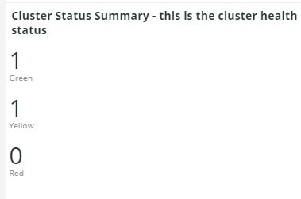

選択した期間にわたって、**[!UICONTROL Cluster Status Summary]** フレームには、[!DNL Elasticsearch] クラスターが通過した色のステータスが表示されます。 この例では、選択した時間枠の間に、クラスターは1回は緑色のステータスで、選択した時間枠の間は1回は黄色のステータスでした。

## [!UICONTROL Active Primary Shards]

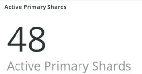

**[!UICONTROL Active Primary Shards]** フレームには、選択したアカウントの[!DNL Elasticsearch] サービスのアクティブなプライマリシャードの数に応じた異なる数値が表示されます。

[!DNL Elasticsearch]より：決定版ガイド [2.x]:

「[動的に更新可能なインデックス &#x200B;](https://www.elastic.co/guide/en/elasticsearch/guide/2.x/dynamic-indices.html)では、シャードがLucene インデックスであり、[!DNL Elasticsearch] インデックスがシャードのコレクションであることを説明しました。 アプリケーションはインデックスに接続し、[!DNL Elasticsearch]はリクエストを適切なシャードにルーティングします。 シャードはスケールの単位です。 最小のインデックスは、単一のシャードを持つインデックスです。 これはニーズには十分すぎるかもしれませんが、単一のシャードには大量のデータを保持することができますが、拡張には限界があります。」

インデックスを作成すると、そのインデックスで複数のシャードが作成されます。 デフォルトでは、5つのプライマリシャードが新しいインデックスごとに割り当てられます。つまり、インデックスは5つのノード（ノードごとに1つのシャード）に分散できます。 レプリカシャードもあります。 これらは主にフェイルオーバー用です。 レプリカシャードは読み取りリクエストを処理できます。

## [!UICONTROL Active Shards in Cluster]

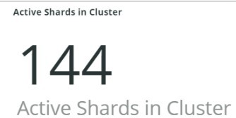

**[!UICONTROL Active Shards in Cluster]** フレームは、[!DNL Elasticsearch] クラスター内のプライマリシャードとレプリカシャードの合計数を示します。

## [!UICONTROL Index health - this will show the index name and color status]

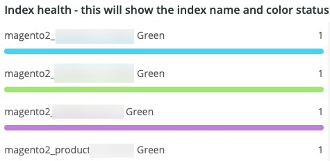

このフレームには、インデックス名とインデックスカラーのステータス数が表示されます。 テーブルを下にスクロールすると、黄色と赤のステータスを持つ同じインデックス名が表示されます。 27のインデックス名の後に続く番号は、ステータスカラーのカウントです。 ゼロの場合、選択した時間枠の間にそのカラーステータスにあるインデックスのインスタンスはありませんでした。

## [!UICONTROL Elasticsearch Status by node information]

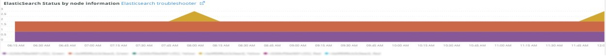

**[!UICONTROL Elasticsearch Status by node information]** フレームには、色とノードごとに[!DNL Elasticsearch] クラスターのステータスが表示されます。 これは、選択した期間に[!DNL Elasticsearch] クラスターのどのノードがどのステータスを返しているかを示すのに役立ちます。

## [!UICONTROL Elasticsearch index information]

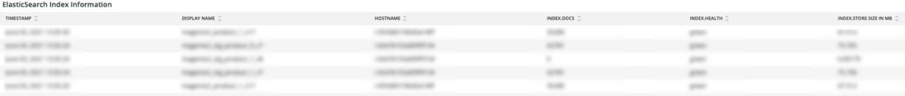

**[!UICONTROL Elasticsearch index information]** テーブルには、インデックス名、そのノード、インデックス付きドキュメントの数、インデックスの正常性、および特定の時点でのMB単位のインデックスサイズが表示されます。

## [!UICONTROL Elasticsearch process CPU %]

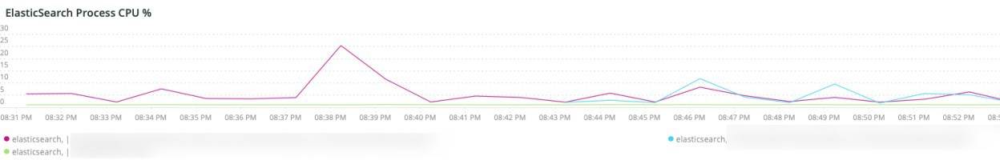

**[!UICONTROL Elasticsearch process CPU %]** フレームは、選択した期間における[!DNL Elasticsearch] プロセスによるプロセスのCPU パーセントを示します。

## [!UICONTROL Elasticsearch Memory garbage collection]

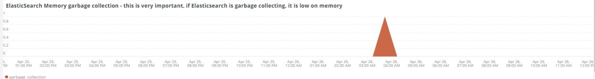

[!DNL Elasticsearch]はJava プロセスです。 割り当てられたメモリが少ない場合は、ガベージコレクションを開始してメモリを解放します。 ガベージコレクションが頻繁に発生する場合は、割り当てられたメモリに対してインデックスまたはシャードが多すぎる可能性があることを示しています。 インデックスとシャードをクリーンアップする機会があるかもしれませんし、[!DNL Elasticsearch]にはさらにメモリが必要な場合もあります。

## [!UICONTROL Elasticsearch Index information]

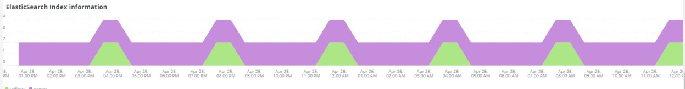

インデックスが作成および更新されると、インデックスの正常性が変更される可能性があります。

## [!UICONTROL Elasticsearch Index Size]

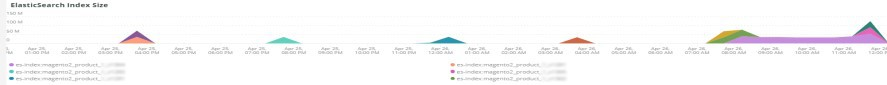

**[!UICONTROL Elasticsearch Index Size]** フレームは、選択した時間枠のインデックス名とサイズを示します。 サイトのインデックス作成に関する問題を示している可能性があります。

## [!UICONTROL Elasticsearch Errors]

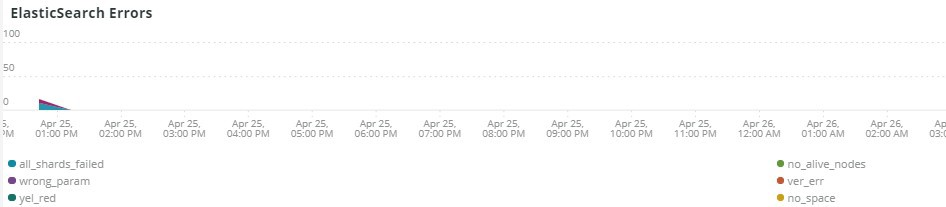

**[!UICONTROL Elasticsearch Errors]** フレームには、すべてのシャードが失敗した場合、検索に関するパラメーターの問題がある場合、バージョンエラー、すべてのノードが利用できない場合など、[!DNL Elasticsearch]のエラーが表示され、空き容量が不足している場合、黄色から赤のステータスに切り替わります。

## [!UICONTROL Elasticsearch Unassigned Shards]:

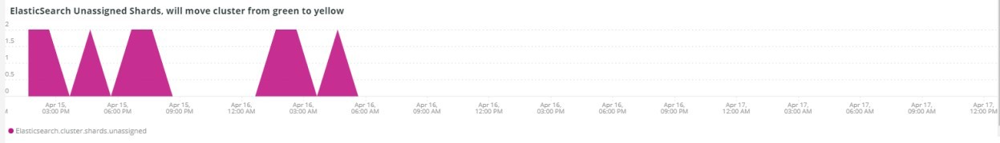

未割り当てのシャードを使用すると、クラスターが緑色から黄色に移動します。
