# 「[!UICONTROL MySQL]」タブ

## [!UICONTROL MySQL% free storage by node]

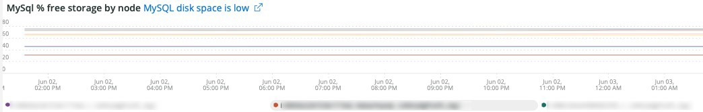

多くの問題は、MySQLに割り当てられたストレージ（`datadir` MySQL構成設定、デフォルトは`/data/mysql`）または`tmpdir`のストレージが不足していることが原因で発生します。 既定の`tmpdir` （MySQL設定）は`/tmp`です。 **[!UICONTROL MySQL% free storage by node]** フレームは、`/, /tmp` （別のマウントとして定義されている場合）と空きストレージの`/data/mysql` パーセンテージを参照します。 MySQL バージョン 5.7 （MariaDB バージョン 10.2）以降、非圧縮`tmp` テーブルは、ファイル （ibtmp1）の`/data/mysql` ディレクトリの`tmp` テーブルスペースに書き込まれます。 このファイルは、デフォルトで制限なしで自動的に拡張されます。 テーブルスペースであるため、MySQLの再起動時にサイズが減少せず、12MBにリセットされます。

## [!UICONTROL MySQL Connections by Node]

ノード 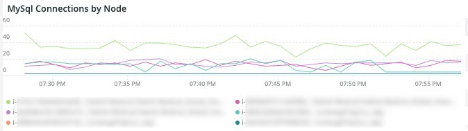によるMySQL接続

**[!UICONTROL MySQL Connections by Node]** フレームは、データベース ノードの停止または大量の接続の期間を示します。

## [!UICONTROL MySQL Node Summary]

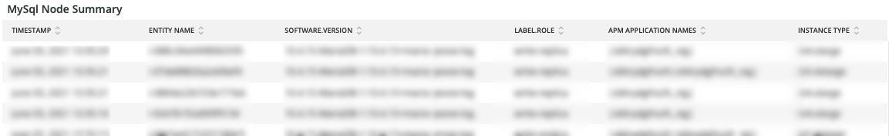

**[!UICONTROL MySQL Node Summary]** テーブルには、ソフトウェアのバージョンやインスタンスの種類（サイズ）などのデータベース ノードの詳細が表示されます。

## [!UICONTROL Galera Number of Nodes in cluster]

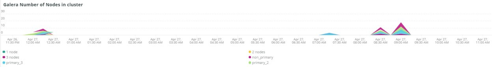

**[!UICONTROL Galera Number of Nodes in cluster]** フレームには、MySQL ログの情報が表示されます。 ノードが結合してクラスタを離れると、選択した時間枠のメッセージのみが表示されます。 ノードがタイムフレームの前にクラスタを離れた場合、そのタイムフレーム中にメッセージは存在しません。 データベースがノード不足の可能性があると思われる場合は、タイムフレームを大きな期間に拡大して、追加情報が表示されるかどうかを確認します。 [!DNL Galera] クラスター内のすべてのノードよりも少ないことを示す情報が期間内に存在する場合は、そのノードがいつクラスターから離脱したかを判断できるように期間を拡張します。

## [!UICONTROL MySQL shutdowns and starts]

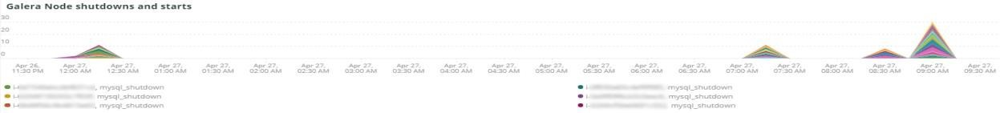

**[!UICONTROL MySQL shutdowns and starts]** フレームは、ノードのシャットダウンが発生したときに検出します。 [!DNL Galera] ノードは削除され、[!DNL Galera] ノードから自己削除されます。 これは通常、MySQL サービスの再起動になります。

## [!UICONTROL Galera log]

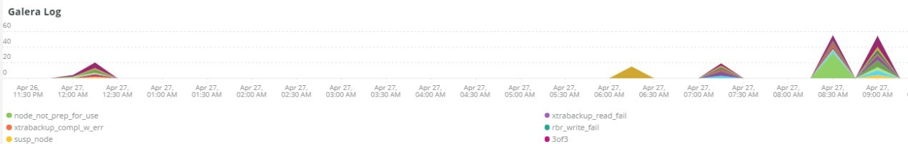

**[!UICONTROL Galera log]** フレームには、[!DNL Galera] ノード、その状態、[!DNL Galera] クラスターの状態変更に関するMySQL ログからの特定のシグナルの数が表示されます。

* &#39;%1047 WSREPはまだアプリケーション用にノードを準備していません%&#39;）。&#39;node_not_prep_for_use&#39;として
* &#39;%\[ERROR\] WSREP: Wsrep_sst_xtrabackup-v2%&#39;）を「xtrabackup_read_fail」として読み取れませんでした
* &#39;%\[ERROR\] WSREP: プロセスが完了しました。エラー：wsrep_sst_xtrabackup-v2 %&#39;） as &#39;xtrabackup_compl_w_err&#39;
* &#39;%\[ERROR\] WSREP: rbr write fail%） as &#39;rbr_write_fail&#39;
* &#39;%self-leave%&#39;） as &#39;susp_node&#39;
* &#39;%members = 3/3 （joined/total） %&#39;） as&#39;3of3&#39;
* &#39;%members = 2/3 （joined/total） %&#39;） as&#39;2of3&#39;
* &#39;%members = 2/2%&#39;） as &#39;2of2&#39;
* &#39;%members = 1/2%&#39;） as &#39;1of2&#39;
* &#39;%members = 1/3%&#39;） as &#39;1of3&#39;
* &#39;%members = 1/1%&#39;） as &#39;1of1&#39;
* &#39;%\[Note\] /usr/sbin/mysqld （mysqld 10.%&#39;） as&#39;sql_restart&#39;
* &#39;%Quorum: No node with complete state:%&#39;） as &#39;no_node_count&#39;
* &#39;%WSREP: Member 0%&#39;）を&#39;mem_0&#39;として指定します
* &#39;%WSREP: Member 1.0%&#39;） as &#39;mem_1&#39;
* &#39;%WSREP: Member 2%&#39;） as&#39;mem2&#39;
* &#39;%WSREP: Synchronized with group, ready for connections%&#39;） as &#39;ready&#39;
* &#39;%/usr/sbin/mysqld, Version:%&#39;）を「mysql_restart_mysql.slow」として使用します。
* &#39;%\[Note\] WSREP：新しいクラスタービュー：グローバル状態：%&#39;）を「galera_cluster_view_chng」として

## [!UICONTROL Galera Log by Host]

ホスト別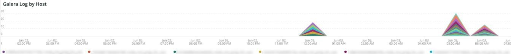

**[!UICONTROL Galera Log by Host]** フレームは、**[!UICONTROL Galera log]** フレームと同じですが、トラブルシューティングに役立つようにノード別に分割されています。

## [!UICONTROL Database performance]

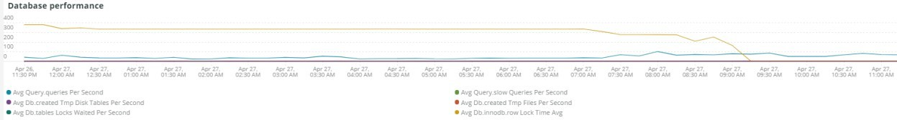

**[!UICONTROL Database performance]** フレームには、特定のリクエスト中のデータベースのパフォーマンスが表示されます。 グラフの下にある色付きのアイコンで各指標をクリックすると、各指標を確認できます。 [New Relicを使用したMySQL データベースのパフォーマンスの監視](https://newrelic.com/blog/how-to-relic/how-to-monitor-mysql)で呼び出された指標の多くがこのフレームにあります。

* average （query.queriesPerSecond）
* average （query.slowQueriesPerSecond）
* average （db.createdTmpDiskTablesPerSecond）
* average （db.createdTmpFilesPerSecond）
* average （db.tablesLocksWaitedPerSecond）
* average （db.innodb.rowLockTimeAvg）
* average （db.innodb.rowLockWaitsPerSecond）

## [!UICONTROL Transaction Database Call Count]

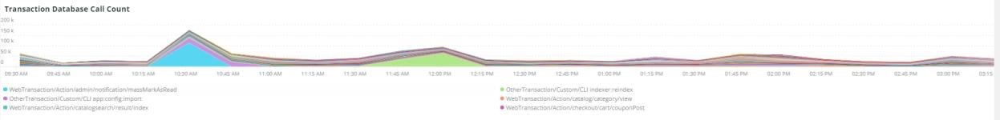

**[!UICONTROL Transaction Database Call Count]** フレームには、各トランザクションファセットによって行われたデータベース呼び出しの数が表示されます。 これは、行に焦点を当てたもので、ステートメントではないようです。

## [!UICONTROL Cron_schedule table updates]

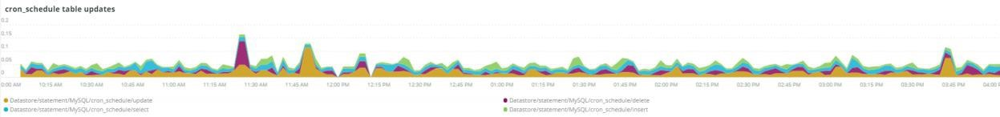

**[!UICONTROL Cron_schedule table updates]** フレームには、選択した期間のcron_schedule テーブルに対するデータベース更新の最大期間が表示されます。

## [!UICONTROL Slow Query Traces]

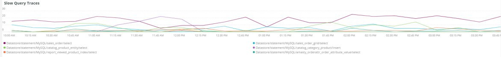

**[!UICONTROL Slow Query Traces]** フレームには、低速のクエリトレースが存在するテーブルとリクエストタイプが表示されます。 5秒以上かかるクエリトランザクションに対して、低速のクエリトレースが作成されます。 このフレームで重要なのは、更新クエリです。 テーブルが`UPDATE`、`DELETE`、`INSERT`のステートメントによって更新されている場合、テーブルは一定期間ロックされる可能性があります。

FOR UPDATEで使用する場合、`SELECT` ステートメントでも行がロックされる可能性があります。

## [!UICONTROL Datastore Operations tables]

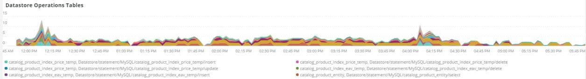

## [!UICONTROL Cron table change]

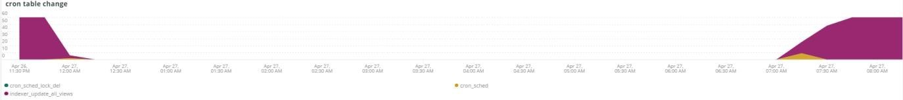

**[!UICONTROL Cron table change]** フレームは、「cron ジョブのロックを取得できませんでした：」というエラーメッセージと、特定のPHP メモリ エラー、および`cron_schedule` テーブルを含むロックを探します。 `cron_schedule` テーブルがロックされている場合（例えば、`DELETE` クエリが実行されているなど）、他のcronの実行をブロックします。

## [!UICONTROL Deadlocks]

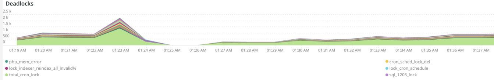

**[!UICONTROL Deadlocks]** フレームは、MySQL ログから解析された次の文字列を調べます。

* &#39;%PHP Fatal error: Allowed memory size of%&#39;） as php_mem_error
* &#39;%get lock; トランザクションを再開しようとしました。クエリ：DELETE FROM \&#39;cron_schedule%&#39;） as cron_sched_lock_del
* &#39;% lock for cron job: indexer_reindex_all_invalid%&#39;） as &#39;lock_indexer_reindex_all_invalid%&#39;
* &#39;% lock for cron job: cron_schedule%&#39;） as &#39;lock_cron_schedule&#39;
* &#39;% lock for cron job:%&#39;） as &#39;total_cron_lock&#39;
* &#39;%General error: 1205 Lock wait timeout exceeded%&#39;） as &#39;sql_1205_lock&#39;
* &#39;%ERROR 1213 （40001）: lock%&#39;を&#39;sql_1213_lock&#39;として取得しようとしたときにデッドロックが見つかりました
* &#39;%SQLSTATE[40001]: シリアル化エラー：1213 デッドロックが見つかりました%&#39;）を&#39;sql_1213_lock2&#39;として
* &#39;% lock for cron job: indexer_update_all_views%&#39;） as &#39;lock_indexer_update_all_views&#39;
* &#39;% lock for cron job: sales_grid_order_invoice_async_insert%&#39;） as &#39;lock_sales_grid_order_invoice_async_insert&#39;,
* &#39;% lock for cron job: staging_remove_updates%&#39;） as &#39;lock_staging_remove_updates&#39;
* &#39;% lock for cron job: sales_grid_order_shipment_async_insert%&#39;） as &#39;lock_sales_grid_order_shipment_async_insert&#39;
* cron ジョブの&#39;% ロック：amazon_payments_process_queued_refunds%&#39;） as &#39;lock_amazon_payments_process_queued_refunds&#39;
* &#39;% lock for cron job: sales_send_order_shipment_emails%&#39;） as &#39;lock_sales_send_order_shipment_emails&#39;
* &#39;% lock for cron job: staging_synchronize_entities_period%&#39;） as &#39;lock_staging_synchronize_entities_period&#39;
* &#39;% lock for cron job: indexer_clean_all_changelogs%&#39;） as &#39;lock_indexer_clean_all_changelogs&#39;
* &#39;% lock for cron job: magento_targetrule_index_reindex%&#39;） as &#39;lock_magento_targetrule_index_reindex&#39;
* &#39;% lock for cron job: newsletter_send_all%&#39;） as &#39;lock_newsletter_send_all&#39;
* &#39;% lock for cron job: newsletter_send_all%&#39;） as &#39;lock_newsletter_send_all&#39;
* &#39;% lock for cron job: sales_send_order_emails%&#39;） as &#39;lock_sales_send_order_emails&#39;
* &#39;% lock for cron job: sales_send_order_creditmemo_emails%&#39;） as &#39;lock_sales_send_order_creditmemo_emails&#39;
* &#39;% lock for cron job: sales_grid_order_creditmemo_async_insert%&#39;） as &#39;lock_sales_grid_order_creditmemo_async_insert&#39;
* &#39;% lock for cron job: bulk_cleanup%&#39;） as &#39;lock_bulk_cleanup&#39;
* &#39;% lock for cron job: flush_preview_quotas%&#39;） as &#39;lock_flush_preview_quotas&#39;
* &#39;% lock for cron job: sales_send_order_invoice_emails%&#39;） as &#39;lock_sales_send_order_invoice_emails&#39;
* &#39;% lock for cron job: sales_send_order_invoice_emails%&#39;） as &#39;lock_sales_send_order_invoice_emails&#39;
* &#39;% lock for cron job: captcha_delete_expired_images%&#39;） as &#39;lock_captcha_delete_expired_images&#39;
* &#39;% lock for cron job: magento_newrelicreporting_cron%&#39;） as &#39;lock_magento_newrelicreporting_cron&#39;
* &#39;% lock for cron job: outdated_authentication_failures_cleanup%&#39;） as &#39;lock_outdated_authentication_failures_cleanup&#39;
* &#39;% lock for cron job: send_notification%&#39;） as &#39;lock_send_notification&#39;
* &#39;% lock for cron job: magento_giftcardaccount_generage_codes_pool%&#39;） as &#39;lock_magento_giftcardaccount_generage_codes_pool&#39;
* &#39;% lock for cron job: catalog_product_frontend_actions_flush%&#39;） as &#39;lock_catalog_product_frontend_actions_flush&#39;
* &#39;% lock for cron job: mysqlmq_clean_messages%&#39;） as &#39;mysqlmq_clean_messages&#39;
* &#39;% lock for cron job: catalog_product_attribute_value_synchronize%&#39;） as &#39;lock_catalog_product_attribute_value_synchronize&#39;
* &#39;% lock for cron job: ddg_automation_importer%&#39;） as &#39;lock_ddg_automation_importer&#39;
* &#39;% lock for cron job: ddg_automation_reviews_and_wishlist%&#39;） as &#39;lock_ddg_automation_reviews_and_wishlist&#39;
* &#39;% lock for cron job: captcha_delete_old_attempts%&#39;） as &#39;lock_captcha_delete_old_attempts&#39;
* &#39;% lock for cron job: catalog_product_outdated_price_values_cleanup%&#39;） as &#39;lock_catalog_product_outdated_price_values_cleanup&#39;
* &#39;% lock for cron job: consumers_runner%&#39;） as &#39;lock_consumers_runner&#39;
* cron ジョブの&#39;% ロック：ddg_automation_customer_subscriber_guest_sync%&#39;） as &#39;lock_ddg_automation_customer_subscriber_guest_sync&#39;
* &#39;% lock for cron job: get_amazon_capture_updates%&#39;） as &#39;lock_get_amazon_capture_updates&#39;
* &#39;% lock for cron job: get_amazon_authorization_updates%&#39;） as &#39;lock_send_get_amazon_authorization_updates&#39;
* &#39;% lock for cron job: temando_process_platform_events%&#39;） as &#39;lock_temando_process_platform_events&#39;
* &#39;% lock for cron job: ddg_automation_status%&#39;） as &#39;lock_ddg_automation_status&#39;
* &#39;% lock for cron job: ddg_automation_status%&#39;） as &#39;lock_ddg_automation_status&#39;
* &#39;% lock for cron job: sales_clean_orders%&#39;） as &#39;lock_sales_clean_orders&#39;
* &#39;% lock for cron job: catalog_index_refresh_price%&#39;） as &#39;lock_catalog_index_refresh_price&#39;
* &#39;% lock for cron job: magento_reward_balance_warning_notification%&#39;） as &#39;lock_magento_reward_balance_warning_notification&#39;
* &#39;% lock for cron job: analytics_update%&#39;） as &#39;lock_analytics_update&#39;
* &#39;% lock for cron job: messagequeue_clean_outdated_locks%&#39;） as &#39;lock_messagequeue_clean_outdated_locks&#39;
* &#39;% lock for cron job: messagequeue_clean_outdated_locks%&#39;） as &#39;lock_messagequeue_clean_outdated_locks&#39;
* &#39;% lock for cron job: staging_apply_version%&#39;） as &#39;lock_staging_apply_version&#39;
* &#39;% lock for cron job: magento_reward_expire_points%&#39;） as &#39;lock_magento_reward_expire_points&#39;
* &#39;% lock for cron job: yotpo_yotpo_orders_sync%&#39;） as &#39;lock_yotpo_yotpo_orders_sync&#39;
* &#39;% lock for cron job: catalog_event_status_checker%&#39;） as &#39;lock_catalog_event_status_checker&#39;
* &#39;% lock for cron job: ddg_automation_campaign%&#39;） as &#39;lock_ddg_automation_campaign&#39;
* &#39;% lock for cron job: visitor_clean%&#39;） as &#39;lock_visitor_clean&#39;
* &#39;% lock for cron job: scconnector_verify_website%&#39;） as &#39;lock_scconnector_verify_website&#39;
* &#39;% lock for cron job: ddg_automation_email_templates%&#39;） as &#39;lock_ddg_automation_email_templates&#39;
* &#39;% lock for cron job: aggregate_sales_report_order_data%&#39;） as &#39;lock_aggregate_sales_report_order_data&#39;
* cron ジョブの&#39;% ロック：ddg_automation_catalog_sync%） as &#39;lock_ddg_automation

## [!UICONTROL DB Statistics]

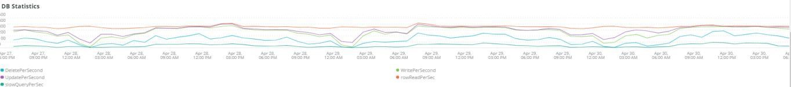

**[!UICONTROL DB Statistics]** フレームには、1秒間に削除、書き込み、読み取られた行、更新、および低速クエリが表示されます。

## [!UICONTROL Request frequency]

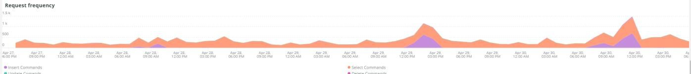

## [!UICONTROL Database Errors]

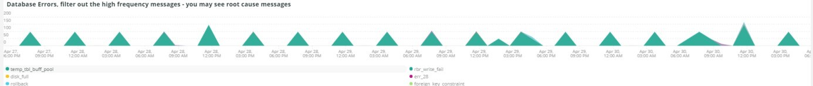

**[!UICONTROL Database Errors]** フレームには、様々なデータベース [の警告とエラー](https://mariadb.com/kb/en/mariadb-error-codes/)が表示されます。

* 一時テーブルに割り当てられた&#39;%Memory サイズは、&#39;temp_tbl_buff_pool&#39;としてinnodb_buffer_pool_size%&#39;の20%を超えています
* &#39;%\[ERROR\] WSREP: rbr write fail%） as &#39;rbr_write_fail&#39;
* &#39;%mysqld: Disk full%&#39;） as &#39;disk_full&#39;
* &#39;%Error number 28%&#39;） as &#39;err_28&#39;
* &#39;%rollback%&#39;）を&#39;rollback&#39;として使用します
* &#39;%Foreign key constraint failed for table%&#39;） as &#39;foreign_key_constraint&#39;
* &#39;%Error_code: 1114%&#39;） as &#39;sql_1114_full&#39;%CRITICAL: SQLSTATE[HY000] [2006] MySQL server has gone%&#39;） as &#39;sql_gone&#39;
* &#39;%SQLSTATE[HY000] [1040]接続が多すぎます%&#39;） as &#39;sql_1040&#39;
* &#39;%CRITICAL: SQLSTATE[HY000] [2002]%&#39;） as &#39;sql_2002&#39;
* &#39;%SQLSTATE[08S01]:%&#39;）を&#39;sql_1047&#39;として使用しています
* &#39;%[警告]は接続を中止しました%）。&#39;aborted_conn&#39;として
* &#39;%SQLSTATE[23000]：整合性制約の違反：%&#39;）を&#39;sql_23000&#39;として返します
* &#39;%1205 Lock wait timeout%&#39;） as &#39;sql_1205&#39;
* &#39;%SQLSTATE[HY000] [1049]不明なデータベース %&#39;）を&#39;sql_1049&#39;として使用します
* &#39;%SQLSTATE[42S02]：基本テーブルまたはビューが見つかりません：%&#39;） as &#39;sql_42S02&#39;
* &#39;%General error: 1114%&#39;）を&#39;sql_1114&#39;として返します
* &#39;%SQLSTATE[40001]%&#39;）を&#39;sql_1213&#39;として使用しています
* &#39;%SQLSTATE[42S22]：列が見つかりません：1054不明な列%&#39;） as &#39;sq1_1054&#39;
* &#39;%SQLSTATE[42000]：構文エラーまたはアクセス違反：%&#39;） as&#39;sql_42000&#39;
* &#39;%SQLSTATE[21000]: カーディナリティ違反：%&#39;）を&#39;sql_1241&#39;として返します
* &#39;%SQLSTATE[22003]:%&#39;）を&#39;sql_22003&#39;として使用します
* &#39;%SQLSTATE[HY000] [9000] Client with IP address%&#39;） as &#39;sql_9000&#39;
* &#39;%SQLSTATE[HY000]：一般エラー：2014%&#39;） as &#39;sql_2014&#39;
* &#39;%1927 Connection was killed%&#39;） as &#39;sql_1927&#39;
* &#39;%1062 \[ERROR\] InnoDB:%&#39;）を&#39;sql_1062_e&#39;として使用します
* &quot;%[Note] WSREP: Flushing memory map to disk...%&#39;） as &#39;mem_map_flush&#39;
* &#39;%Internal MariaDB エラーコード：1146%&#39;） as &#39;sql_1146&#39;
* &#39;%Internal MariaDB エラーコード：1062%&#39;） as &#39;sql_1062&#39; * &#39;%1062 [警告] InnoDB:%&#39;） as &#39;sql_1062_w&#39;
* &#39;%Internal MariaDB エラーコード：1064%&#39;） as &#39;sql_1064&#39;
* &#39;%InnoDB: アサーションエラー（ファイル %）） as &#39;assertion_err&#39;
* &#39;%mysqld_safe現在実行中のプロセスの数：0%） as &#39;mysql_oom&#39;
* &#39;%\[ERROR\] mysqld got signal%&#39;）を&#39;mysql_sigterm&#39;として返します
* &#39;%1452 Cannot add%&#39;） as &#39;sql_1452&#39;
* &#39;%ERROR 1698%&#39;） as &#39;sql_1698&#39;
* &#39;%SQLSTATE[HY000]：一般的なエラー：3%&#39;）を&#39;cnt_wrt_tmp&#39;として指定します
* &#39;%一般エラー：1 %&#39;）を&#39;sql_syntax&#39;として返します
* &#39;%42S22%&#39;） as &#39;sql_42S22&#39;
* &#39;%InnoDB: エラー（キーの重複） %&#39;） as &#39;innodb_dup_key&#39; FROM Log TIMESERIES

## [!UICONTROL DB Error Table]

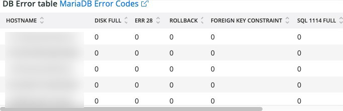

**[!UICONTROL DB Error Table]** フレームは&#x200B;**[!UICONTROL Database Errors]** フレームと同じ情報を表示しますが、ノード別およびテーブル形式で表示できます。 詳しくは、[MariaDB エラーコード &#x200B;](https://mariadb.com/kb/en/mariadb-error-codes/)を参照してください。

## [!UICONTROL Database Traces]

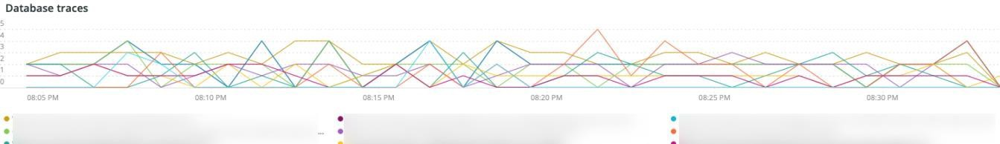

**[!UICONTROL Database Traces]** フレームには、選択したタイムラインのタイプ別のデータベーストレースが表示されます。

## [!UICONTROL Database processes]

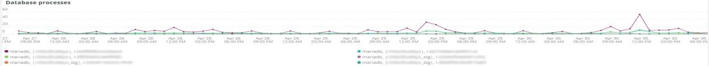

**[!UICONTROL Database processes]** フレームには、データベース プロセス、環境、およびノード IDが表示されます。

## [!UICONTROL MySQL Non-Sleeping Threads by Node]

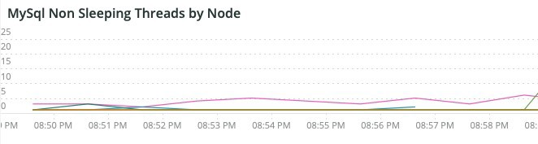

**[!UICONTROL MySQL Non-Sleeping Threads by Node]** フレームには、データベースへの接続スレッドが表示されます。 このフレームにはアクティブなスレッドが表示されます。

## [!UICONTROL MySQL Running and Sleeping Threads by environment]

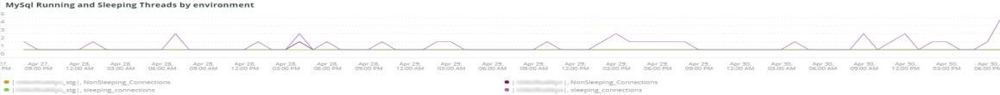

**[!UICONTROL MySQL Running and Sleeping Threads by environment]** フレームには、データベースに対するアクティブ接続とスリープ接続の両方が表示されます。 スロークエリがスリープ状態になったデータベースへの接続がある場合、スリープ状態の接続があります。 スリープ接続は、ロックされた行またはテーブルによってブロックされるデータベースクエリにすることができます。 これらのスリープ中の接続は、PHP ワーカー接続も保持しています。

## [!UICONTROL MySQL mem used by node]

ノード 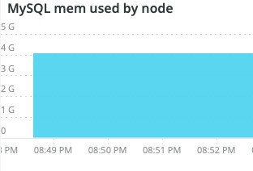によって使用されるMySQL メンバ

**[!UICONTROL MySQL mem used by node]** フレームは、MySQLによるメモリのノード使用状況を示します。 大きなサイトでは、このフレームはGB相当のメモリを使用した連続バーである場合があります。

## [!UICONTROL Database mysql-slow.log]

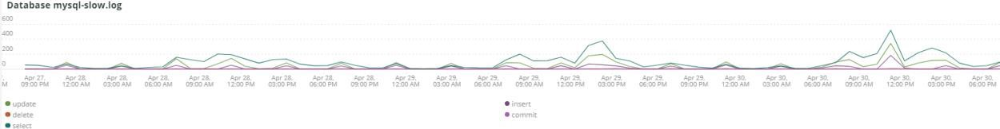

**[!UICONTROL Database mysql-slow.log]** フレームには、選択した期間の`mysql-slow.log` ファイル内にあったクエリ文の種類が表示されます。
