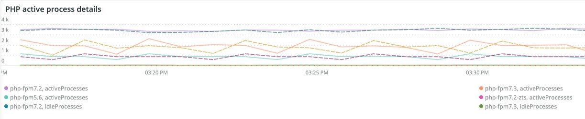
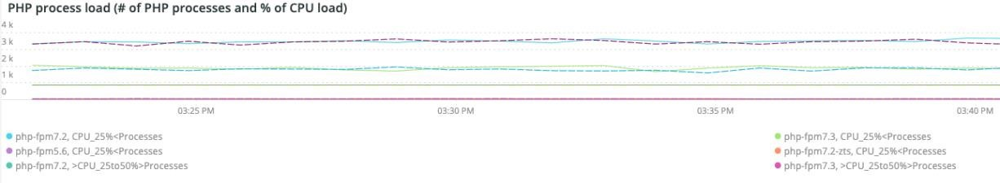
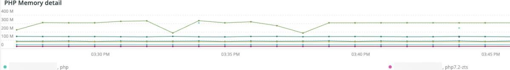
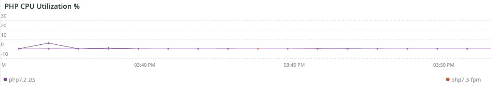
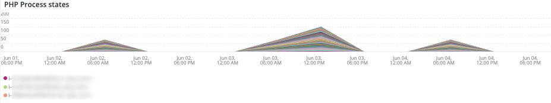
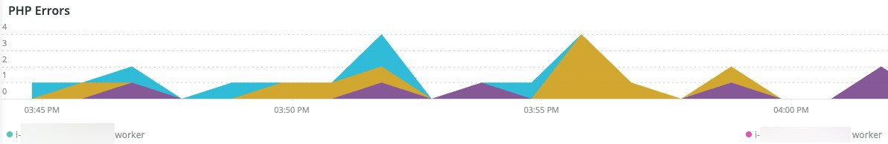
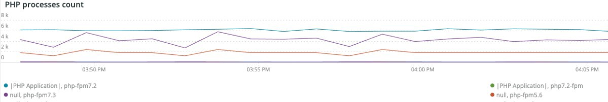
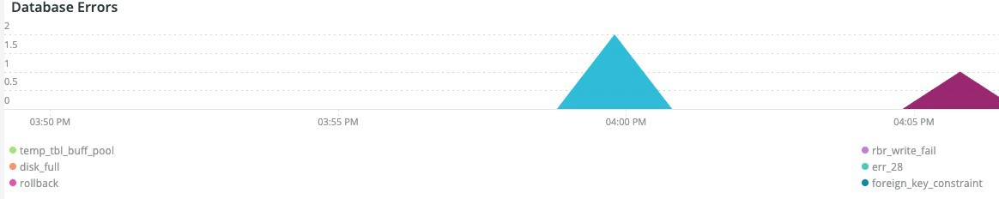
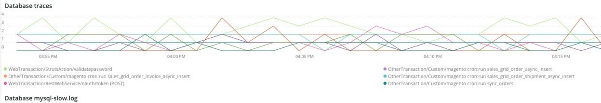
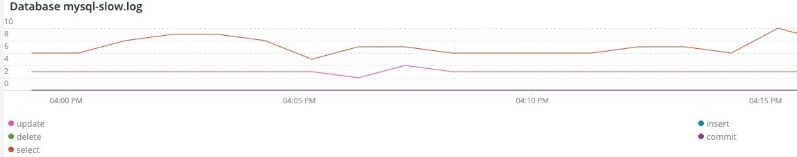

# 「[!UICONTROL PHP]」タブ

「**PHP**」タブには、PHP プロセスの問題が表示され、PHPの問題をより詳細に分析できます。

## [!UICONTROL PHP active process details]

**[!UICONTROL PHP active process details]** フレームには、選択した時間枠のphp-fpmを含むPHP プロセスが表示されます。

## [!UICONTROL PHP process load (# of PHP processes and % of CPU load)]

**[!UICONTROL PHP process load (# of PHP processes and % of CPU load)]** フレームは、選択した時間枠でのPHP-FPM プロセスからのCPUの読み込みを示します。

## [!UICONTROL PHP Memory detail]

**[!UICONTROL PHP Memory detail]** フレームは、選択した期間におけるPHP プロセスのメモリ使用量を示します。

## [!UICONTROL PHP CPU Utilization]

**[!UICONTROL PHP CPU Utilization]** フレームは、選択した時間枠におけるPHP プロセスのCPUのパーセント利用率を示します。

## [!UICONTROL PHP Process states]

**[!UICONTROL PHP Process states]** フレームには、選択した期間におけるPHP プロセスの状態が表示されます。 PHP プロセスが終了して再起動すると表示されます。 再起動が表示されない終了したPHP プロセスに注意してください。

* &#39;%NOTICE: Terminating ...%&#39;） as &#39;php_term&#39;
* &#39;%通知：exiting, bye-bye!%&#39;） as &#39;php_exit&#39;
* &#39;%通知：fpmが実行中です。pid%&#39;） as &#39;fpm_start&#39;
* &#39;%NOTICE: ready to handle connections%&#39;） as &#39;php_ready&#39;

## [!UICONTROL PHP Errors]

**[!UICONTROL PHP Errors]** フレームには、選択した期間におけるPHP ワーカーエラーの数が表示されます。 解析および表示されるエラーメッセージには、次のものが含まれます。

* &#39;%worker_connections are not enough%&#39;） as &#39;worker&#39;
* &#39;%PHP Fatal error: Allowed memory size!%&#39;） as &#39;mem_size&#39;
* &#39;%exited on signal 11 （SIGSEGV） %&#39;） as &#39;sig_11&#39;
* &#39;%exited on signal 7 （SIGBUS） %&#39;） as &#39;sig_7&#39;
* &#39;%increase pm.start_servers%&#39;） as &#39;pmstart_serv&#39;
* &#39;%max_children%&#39;） as &#39;max_children_cnt&#39;
* &#39;%PHP Fatal error: Allowed memory size of%&#39;） as &#39;mem_exhst_coun&#39;
* &#39;%Unable to allocate memory for pool%&#39;） as &#39;opc_mem_count&#39;
* &#39;%Warning Interned string buffer overflow%&#39;） as &#39;opc_str_buf&#39;
* &#39;%Illegal string offsetl%&#39;） as &#39;opc_sv_comments&#39;
* &#39;%PHP Fatal error: Uncaught RedisException: read error on connection%&#39;） as &#39;php_exc&#39;

## [!UICONTROL PHP processes count]

**[!UICONTROL PHP processes count]** フレームには、選択した期間におけるPHP プロセスの数が表示されます。

## [!UICONTROL Database Errors]

**[!UICONTROL Database Errors]** フレームには、選択した期間のデータベース エラーが表示されます。 解析されるエラーは次のとおりです。

* &#39;%一時テーブルに割り当てられたメモリ サイズは、&#39;temp_tbl_buff_pool&#39;としてinnodb_buffer_pool_size%&#39;の20%を超えています
* &#39;%\[ERROR\] WSREP: rbr write fail%） as &#39;rbr_write_fail&#39;
* &#39;%mysqld: Disk full%&#39;） as &#39;disk_full&#39;
* &#39;%Error number 28%&#39;） as &#39;err_28&#39;
* &#39;%rollback%&#39;）を&#39;rollback&#39;として使用します
* &#39;%Foreign key constraint failed for table%&#39;） as &#39;foreign_key_constraint&#39;
* &#39;%Error_code: 1114%&#39;） as &#39;sql_1114_full&#39;
* &#39;%CRITICAL: SQLSTATE[HY000] [2006] MySQL サーバーが「sql_gone」として%）
* &#39;%SQLSTATE[HY000] [1040]接続が多すぎます%&#39;） as &#39;sql_1040&#39;
* &#39;%CRITICAL: SQLSTATE[HY000] [2002]%&#39;） as &#39;sql_2002&#39;
* &#39;%SQLSTATE[08S01]:%&#39;）を&#39;sql_1047&#39;として使用しています
* &#39;%[警告]は接続を中止しました%）。&#39;aborted_conn&#39;として
* &#39;%SQLSTATE[23000]：整合性制約の違反：%&#39;）を&#39;sql_23000&#39;として返します
* &#39;%1205 Lock wait timeout%&#39;） as &#39;sql_1205&#39;
* &#39;%SQLSTATE[HY000] [1049]不明なデータベース %&#39;）を&#39;sql_1049&#39;として使用します
* &#39;%SQLSTATE[42S02]：基本テーブルまたはビューが見つかりません：%&#39;） as &#39;sql_42S02&#39;
* &#39;%General error: 1114%&#39;）を&#39;sql_1114&#39;として返します
* &#39;%SQLSTATE[40001]%&#39;）を&#39;sql_1213&#39;として使用しています
* &#39;%SQLSTATE[42S22]：列が見つかりません：1054不明な列%&#39;） as &#39;sq1_1054&#39;
* &#39;%SQLSTATE[42000]：構文エラーまたはアクセス違反：%&#39;）を&#39;sql_42000&#39;として返します
* &#39;%SQLSTATE[21000]: カーディナリティ違反：%&#39;）を&#39;sql_1241&#39;として返します
* &#39;%SQLSTATE[22003]:%&#39;）を&#39;sql_22003&#39;として使用します
* &#39;%SQLSTATE[HY000] [9000] Client with IP address%&#39;） as &#39;sql_9000&#39;
* &#39;%SQLSTATE[HY000]：一般エラー：2014%&#39;） as &#39;sql_2014&#39;
* &#39;%1927 Connection was killed%&#39;） as &#39;sql_1927&#39;
* &#39;%1062 \[ERROR\] InnoDB:%&#39;）を&#39;sql_1062_e&#39;として使用します
* &#39;%[注] WSREP: メモリ マップをディスクにフラッシュしています…%&#39;）。&#39;mem_map_flush&#39;として指定します
* &#39;%Internal MariaDB エラーコード：1146%&#39;） as &#39;sql_1146&#39;
* &#39;%Internal MariaDB エラーコード：1062%&#39;） as &#39;sql_1062&#39; * &#39;%1062 [警告] InnoDB:%&#39;） as &#39;sql_1062_w&#39;
* &#39;%Internal MariaDB エラーコード：1064%&#39;） as &#39;sql_1064&#39;
* &#39;%InnoDB: アサーションエラー（ファイル %）） as &#39;assertion_err&#39;
* &#39;%mysqld_safe現在実行中のプロセスの数：0%） as &#39;mysql_oom&#39;
* &#39;%\[ERROR\] mysqld got signal%&#39;）を&#39;mysql_sigterm&#39;として返します
* &#39;%1452 Cannot add%&#39;） as &#39;sql_1452&#39;
* &#39;%ERROR 1698%&#39;） as &#39;sql_1698&#39;
* &#39;%SQLSTATE[HY000]：一般的なエラー：3%&#39;）を&#39;cnt_wrt_tmp&#39;として指定します
* &#39;%一般エラー：1 %&#39;）を&#39;sql_syntax&#39;として返します
* &#39;%42S22%&#39;） as &#39;sql_42S22&#39;
* &#39;%InnoDB: エラー（キーが重複） %&#39;） as &#39;innodb_dup_key&#39;

## [!UICONTROL Database traces]

**[!UICONTROL Database traces]** フレームには、データベースのトレース情報が表示されます。 このフレームは、選択したタイムラインのAPM トランザクションの概要ビューと一致します。

## [!UICONTROL Database mysql-slow.log]

**[!UICONTROL Database mysql-slow.log]** フレームには、選択した期間の`mysql-slow.log` ファイル内にあったクエリ文の種類が表示されます。
