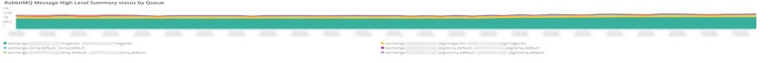
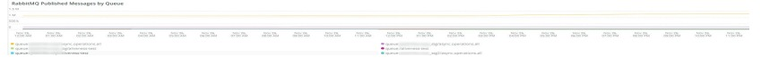
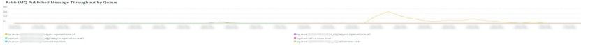
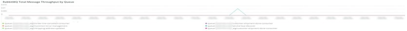
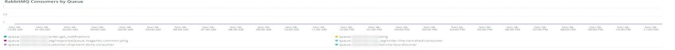

# 「[!UICONTROL [!DNL RabbitMQ]]」タブ

**[!UICONTROL [!DNL RabbitMQ]]** タブには、[!DNL RabbitMQ]個のシグナルに焦点を当てた情報があります。

## [!UICONTROL [!DNL RabbitMQ] Infrastructure events]

![[!DNL RabbitMQ] インフラストラクチャ イベント &#x200B;](../../assets/tools/observation-for-adobe-commerce/rabbitmq-tab-1.jpeg)

**[!UICONTROL [!DNL RabbitMQ] Infrastructure events]** フレームには、選択した時間枠で発生した[!DNL RabbitMQ]を含むインフラストラクチャ イベントが表示されます。

* `%Response [error] for node [rabbit@host1]: unexpected http response from%`）を`unexpected_resp_node1`として
* `%Response [error] for node [rabbit@host2]: unexpected http response from%`）を`unexpected_resp_node2`として
* `%Response [error] for node [rabbit@host3]: unexpected http response from%`）を`unexpected_resp_node3`として
* `%Response [error] for node [rabbit@host3]: Get "http://localhost:15672/api/healthchecks/node/rabbit@host3": context deadline exceeded%`）を`node3_timeout_exceeded`として
* `%Response [error] for node [rabbit@host1]: Get "http://localhost:15672/api/healthchecks/node/rabbit@host1": context deadline exceeded%`）を`node1_timeout_exceeded`として
* `%Response [error] for node [rabbit@host2]: Get "http://localhost:15672/api/healthchecks/node/rabbit@host2": context deadline exceeded%`）を`node2_timeout_exceeded`として
* `%401 Unauthorized%`）を`401_unauth`として
* `%401 Unauthorized%`）を`401_unauth`として
* `%Service restarted: rabbitmq-server%`）を`rmq_service_restart`として
* `%Response [failed] for node [rabbit@host1]: nodedown%`）を`rmq_node1_down`として
* `%Response [failed] for node [rabbit@host2]: nodedown%`）を`rmq_node2_down`として
* `%Response [failed] for node [rabbit@host2]: nodedown%`）を`rmq_node2_down`として
* `%Entity modified: exchange/bindings.destination%`）を`rmq_entity_modified`として
* `%Entity modified: exchange/bindings.destination%`）を`rmq_entity_modified`として
* `%Entity modified: queue/exclusive%`） as `rmq_entity_created_q_exclusive` `%Entity modified: queue/auto_delete%`） as `rmq_entity_q_delete`
* `%Entity modified: queue/durable%`）を`rmq_entity_modified_q_durable`として
* `%Entity modified: version/management%`）を`rmq_entity_modified_ver_mgt`として
* `%Entity modified: version/management%`）を`rmq_entity_modified_ver_mgt`として

## [!UICONTROL [!DNL RabbitMQ] service start/stop signals]

![[!DNL RabbitMQ] サービスの開始/停止シグナル &#x200B;](../../assets/tools/observation-for-adobe-commerce/rabbitmq-tab-2.jpeg)

このフレームには、選択した期間に発生した[!DNL RabbitMQ] サービス開始/停止シグナルが表示されます。

* `%RabbitMQ is asked to stop...%`）を`rabbitmq_stop`として
* `%Starting RabbitMQ%`）を`rabbitmq_start`として

## [!UICONTROL [!DNL RabbitMQ] errors]

![[!DNL RabbitMQ] エラー](../../assets/tools/observation-for-adobe-commerce/rabbitmq-tab-3.jpeg)

このフレームには、選択した期間に発生した[!DNL RabbitMQ] エラーが表示されます。

* `%exit with reason {case_clause,timeout} and stacktrace {rabbit_mgmt_wm_healthchecks%}` as `exit_timeout`
* `%client unexpectedly closed TCP connection%`）を`client_closed_tcp_conn`として
* `%at undefined exit with reason shutdown in context shutdown_error%`）を`undef_exit`として
* `%Connection attempt from disallowed node%`）を`disallowed_node`として
* `%closing AMQP connection%`）を`rmq_err_amqp_conn`として

## [!UICONTROL [!DNL RabbitMQ] node status]

![[!DNL RabbitMQ] ノードの状態](../../assets/tools/observation-for-adobe-commerce/rabbitmq-tab-4.jpeg)

* `%rabbit on node rabbit@host1 down%`）を`rmq_node1_down`として
* `%rabbit on node rabbit@host2 down%`）を`rmq_node2_down`として
* `%rabbit on node rabbit@host3 down%`）を`rmq_node3_down`として
* `%rabbit on node rabbit@host1 up%`）を`rmq_node1_up`として
* `%rabbit on node rabbit@host2 up%`）を`rmq_node2_up`として
* `%rabbit on node rabbit@host3 up%`）を`rmq_node3_up`として

## [!UICONTROL [!DNL RabbitMQ] Message High-Level Summary status by Queue]

キュー別[!DNL RabbitMQ] メッセージの概要ステータス

**[!UICONTROL [!DNL RabbitMQ] Message High-Level Summary status by Queue]** グラフには、選択した期間に[!DNL RabbitMQ] キューが公開したメッセージの数が表示されます。

## [!UICONTROL [!DNL RabbitMQ] Message Detail Summary]

![[!DNL RabbitMQ] メッセージの詳細の概要](../../assets/tools/observation-for-adobe-commerce/rabbitmq-tab-6.jpeg)

* `%report.ERROR: Cron Job consumers_runner has an error: NOT_FOUND - no queue%`）を`queue_err`として
* `%report.ERROR: Cron Job consumers_runner has an error: NOT_FOUND - no queue%`）を`queue_err`として
* `%authenticated and granted access to vhost%`）を`auth`として
* `%closing AMQP connection%`）を`close_conn`として

## [!UICONTROL [!DNL RabbitMQ] Queue Consumption MB]

![[!DNL RabbitMQ] キュー消費MB](../../assets/tools/observation-for-adobe-commerce/rabbitmq-tab-7.jpeg)

**[!UICONTROL [!DNL RabbitMQ] Queue Consumption MB]** グラフには、選択した期間に各[!DNL RabbitMQ] キューが消費したバイト数が表示されます。

## [!UICONTROL [!DNL RabbitMQ] Published Messages by Queue]

キューによって[!DNL RabbitMQ]件の公開されたメッセージ

**[!UICONTROL [!DNL RabbitMQ] Published Messages by Queue]** グラフには、選択した期間に各[!DNL RabbitMQ] キューが消費したバイト数が表示されます。

## [!UICONTROL [!DNL RabbitMQ] Published Message Throughput by Queue]

キューによる[!DNL RabbitMQ]の公開メッセージ スループット

**[!UICONTROL [!DNL RabbitMQ] Published Message Throughput by Queue]** グラフには、選択した期間における各[!DNL RabbitMQ] キューの1秒あたりの公開メッセージの平均数が表示されます。

## [!UICONTROL [!DNL RabbitMQ] Total Message Throughput by Queue]

キューによるメッセージ スループットの合計[!DNL RabbitMQ]

**[!UICONTROL [!DNL RabbitMQ] Total Message Throughput by Queue]** グラフには、選択した期間における各[!DNL RabbitMQ] キューの1秒あたりのメッセージの平均合計数が表示されます。

## [!UICONTROL [!DNL RabbitMQ] Consumers by Queue]

キュー別[!DNL RabbitMQ] コンシューマー

**[!UICONTROL [!DNL RabbitMQ] Consumers by Queue]** グラフには、選択した期間における各[!DNL RabbitMQ] キューの平均合計コンシューマー数が表示されます。
