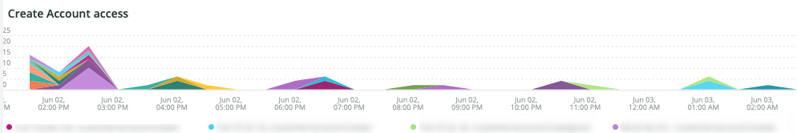
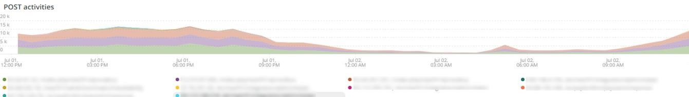
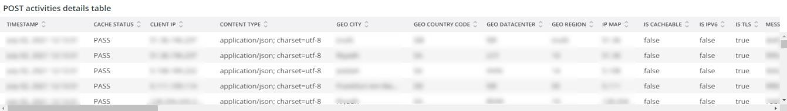
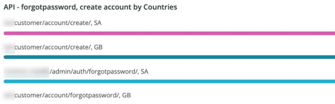
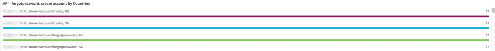
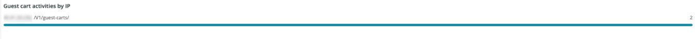
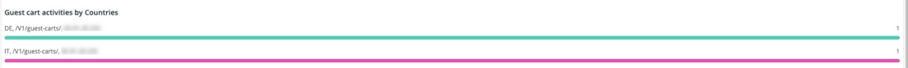

# 「[!UICONTROL Security]」タブ

「**[!UICONTROL Security]**」タブでは、セキュリティの問題について説明し、その潜在的な原因を特定します。 さらに、タブのフレームについて説明する。

## [!UICONTROL API calls by IP, details by URL]

**[!UICONTROL API calls by IP, details by URL]** フレームには、選択した期間におけるIPによるAPI呼び出しの数が表示されます。 このフレームには、IP アドレスと、そのIP アドレスによってアクセスされたAPI URLが表示されます。

IP](../../assets/tools/observation-for-adobe-commerce/calls-by-ip.jpg)による![API呼び出し

## [!UICONTROL Forgot Password]

**[!UICONTROL Forgot Password]** アクセス フレームには、選択した期間にパスワードを忘れた回数が表示されます。 IP アドレスに対する高いアクティビティは、サイト上の攻撃である可能性があります。

## [!UICONTROL Create Account access]

**[!UICONTROL Create Account access]** フレームには、選択した期間における新しいアカウントアクティビティの数が表示されます。 単一のIP アドレスからのアクティビティが多い場合は、攻撃を示している可能性があります。

## [!UICONTROL POST activities]

**[!UICONTROL POST activities]** フレームには、[!DNL Fastly]件のログから`client_ip`にファセットされた、サイトの`POST`件のアクティビティが表示されます。 また、IP アドレスからアクセスされるURLも表示されます。

## [!UICONTROL POST activities summary table]

**[!UICONTROL POST activities summary table]** フレームには、[!DNL Fastly]件のログから`client_ip`にファセットされた、サイトの要約`POST`件のアクティビティが表示されます。 また、IP アドレスによってアクセスされるURLの数も表示されます。 カウントは選択した期間のものです。

## [!UICONTROL POST activities details table]

**[!UICONTROL POST activities details table]** フレームには、[!DNL Fastly] ログからのサイトの`POST` アクティビティが表示されます。 また、これらのリクエストの[!DNL Fastly] ログのすべての詳細も表示されます。 最後の2000件のリクエストに限定されます。

## [!UICONTROL Guest Carts activities]

**[!UICONTROL Guest Carts activities]** フレームには、選択した期間におけるゲスト カート アクティビティの数が、IP アドレスとアクセスされたURLによってファセットされて表示されます。 ゲストカートはカード攻撃に使用される可能性があります。 このフレームは、ゲストカートのURLにアクセスしたリクエストの合計数を示します。

## [!UICONTROL API – forgot password, create account by Countries]

**[!UICONTROL API – forgot password, create account by Countries]** フレームには、選択した期間にパスワードを忘れた場合にリセットするアカウントの作成数とリクエスト数が表示されます。 リクエストの原産国も表示されます。 このフレームは、リクエストの原産国に焦点を当てています。

## [!UICONTROL API - forgot password, create account by Countries and IP address]

**[!UICONTROL API - forgot password, create account by Countries and IP address]** フレームには、選択した期間にパスワードを忘れた場合にリセットするアカウントの作成数とリクエスト数が表示されます。 ファセットには、リクエストのIP アドレス、アクセスされたURL、および送信元の国も表示されます。 このフレームはIPのカウントに焦点を当てています。

## [!UICONTROL Guest cart activities by IP]

**[!UICONTROL Guest cart activities by IP]** フレームには、選択した期間のIP別のゲスト カート アクティビティが表示されます。

## [!UICONTROL Guest cart activities by Countries]

**[!UICONTROL Guest cart activities by Countries]**&#x200B;枠には、選択した期間の国ごとのゲストカート活動が表示されます。

