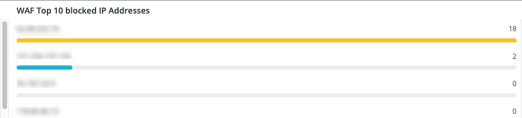
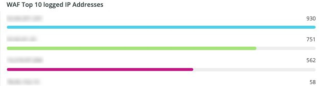

# 「[!DNL WAF]」タブ

「**[!DNL WAF]**」タブには、[!DNL firewall]によって渡され、ブロックされたトラフィックが表示されます。

## [!DNL WAF traffic summary]

**[!DNL WAF traffic summary]** フレームは、[!DNL firewall]によって渡され、ログに記録され、ブロックされ、失敗したトラフィックの数を示します。

## [!DNL WAF Top 10 blocked IP Addresses]

**[!DNL WAF Top 10 blocked IP Addresses]** フレームには、[!DNL firewall]によって最もブロックされた上位10個のIP アドレスが表示されます。

## [!DNL WAF Top 10 countries for blocked requests]

**[!DNL WAF Top 10 countries for blocked requests]** フレームには、[!DNL firewall]によるブロック済みリクエストの上位10以内の国に対するブロック済みリクエストの数が表示されます。

## [!DNL WAF Top 10 logged IP Addresses]

**[!DNL WAF Top 10 logged IP Addresses]** フレームには、[!DNL firewall]によって記録された上位10個のIP アドレスにIP アドレスが表示されます。

## [!DNL Top 10 WAF Rules Executed and Logged by IP address]

**[!DNL Top 10 WAF Rules Executed and Logged by IP address]** フレームには、上位10件のIP アドレスが表示されます。最も頻繁に一致するのは[!DNL firewall] ルールです。

## [!DNL WAF Logged Details]

**[!DNL WAF Logged Details]** フレームには、[!DNL firewall]によって記録されたリクエストが表示され、タイムスタンプ、市区町村、地域、データセンターなどの詳細が表示されます。

## [!DNL WAF Blocked Details]

**[!DNL WAF Blocked Details]** フレームには、[!DNL firewall]によってブロックされたリクエスト（タイムスタンプ、市区町村、地域、データセンターなど）が表示されます。
