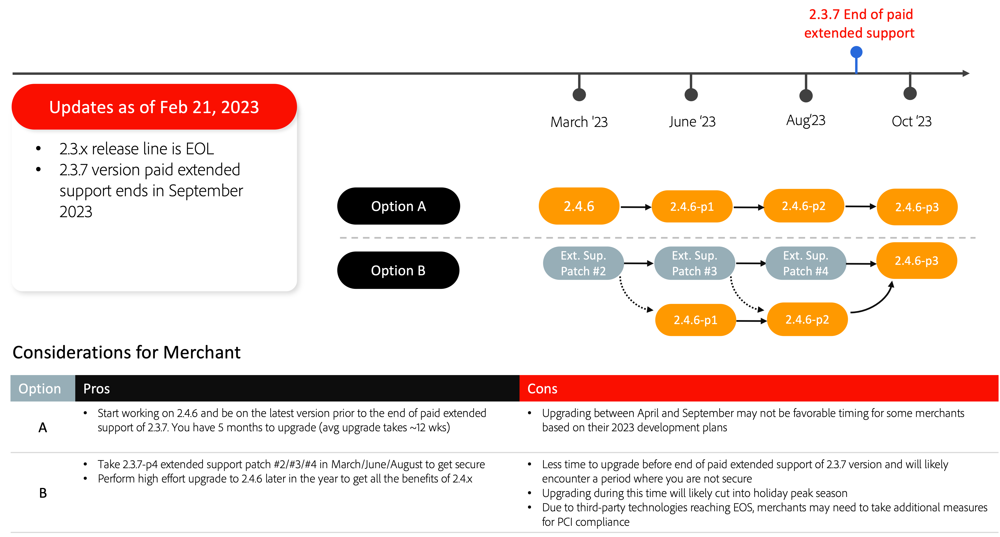
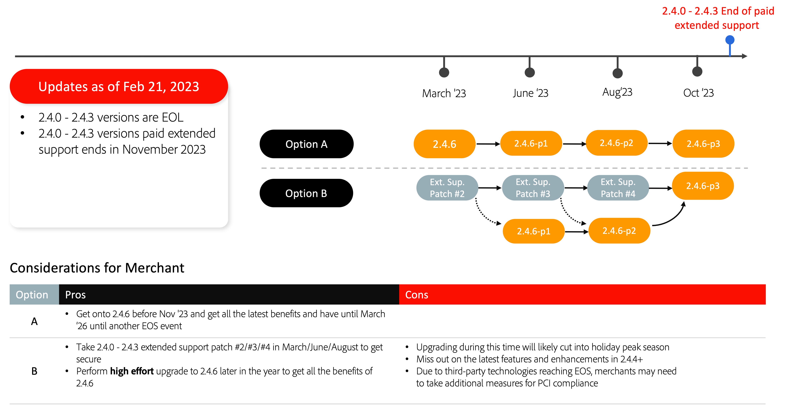
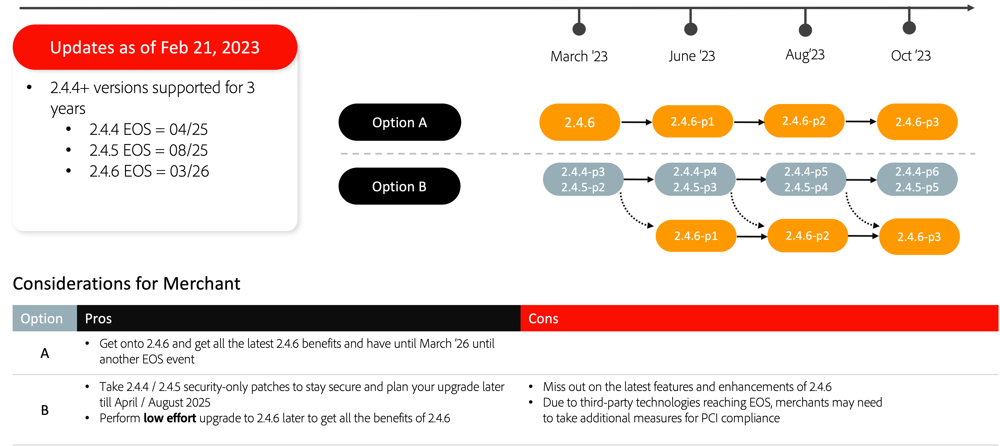

# 推奨されるアップグレードパス

e コマースの導入は進化であり、まだ終わっていません。 顧客の関心を維持する最新の能力と能力を導入することで、企業はトレンドの一歩先を行く必要があります。 最新バージョンのAdobe Commerceにアップグレードすれば、クラス最高のイノベーションで業界トップクラスの優位性を確保し、将来を見据えたビジネスを展開できます。

- SaaS サービスとして提供される革新的な機能への迅速なアクセス
- メンテナンスとアップグレードが容易でコスト効率が向上
- ビジネスニーズに合わせた継続的な柔軟性とカスタマイズ
- パフォーマンスと拡張性が大幅に向上
- 開発者体験とツールの向上
- ほかのAdobe Experience Cloud アプリケーションとの緊密な統合

以下は、最新バージョンにアップグレードする際にサイトのセキュリティとパフォーマンスを維持するために、Adobe Commerceで推奨されるアップグレードパスです。

## 2.3.7からのアップグレード

からアップグレード

## 2.4.0 ～ 2.4.3からのアップグレード

にアップグレード

## 2.4.4および2.4.5からのアップグレード

からアップグレードする
